<p align="center">
  <picture>
    <source media="(prefers-color-scheme: dark)" srcset="docs/assets/screen_stock_dark.png">
    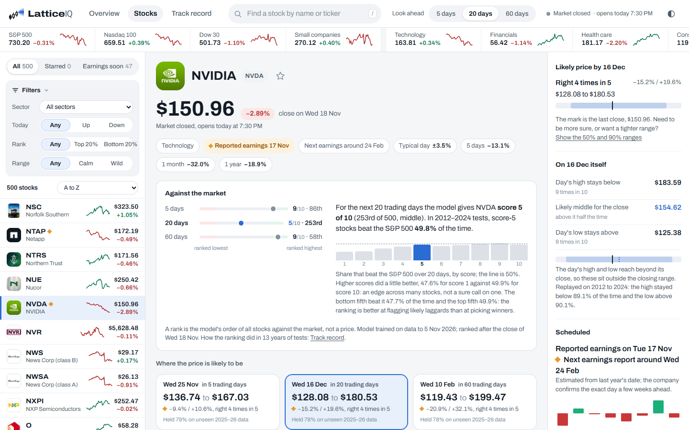
  </picture>
</p>

<p align="center">
  <b>How do S&P 500 stocks rank against the market over the next 5, 20 and 60 trading days, and how far could each price move?</b>
</p>

<p align="center">
  <a href="https://github.com/Naveed-CoLab/LatticeX/actions/workflows/tests.yml"></a>
  
  
  
  
  
  
</p>

<p align="center">
  <a href="#what-it-does">What it does</a> ·
  <a href="#results-at-a-glance">Results</a> ·
  <a href="#models-what-we-picked-and-what-we-dropped">Models</a> ·
  <a href="#system-architecture">Architecture</a> ·
  <a href="#requirements">Requirements</a> ·
  <a href="#quick-start">Quick start</a> ·
  <a href="docs/PROGRESS.md">Progress</a>
</p>

A university final-year project (2026), built to become a product. **New here? Start with [`docs/project-flow.md`](docs/project-flow.md)**: the whole project as one step-by-step story, with the status of each step.

> **Not investment advice.** This is a research project. All results are historical backtests, and no return or profit claim is made.

**Writing a requirements (SRS) or design (SDS) document from this repo?** Use [Requirements](#requirements) for the SRS and [System architecture](#system-architecture) plus [`docs/architecture.md`](docs/architecture.md) for the SDS. The methods and the published research behind each one are in [`docs/methodology.md`](docs/methodology.md). Every model choice with its numbers is in [Models](#models-what-we-picked-and-what-we-dropped) and [`docs/decisions.md`](docs/decisions.md). Terms are explained in the [Glossary](#glossary).

---

## Status (19 Nov 2026)

| Part | State |
|---|---|
| Data: prices, fundamentals, SEC filings, audited S&P 500 membership | Built. Research data frozen as "universe v2" (722 stocks, 2000–2026) |
| Ranking model v1.0 | Final. Measured on 13 test years, trained once on all data, saved, used every day |
| Price ranges (range model v2) | Final. Measured on 2012–2024 and **passed the one-time 2025–26 holdout test** (80% range held 78.9% / 78.1% / 77.8%) |
| Dashboard | Built: three pages, score 1–10, past calls on the chart, real-time prices (IEX) with a delayed fallback, market open or closed. Hosted on one AWS server over HTTPS, open without a login |
| 2025–26 holdout test | Rules fixed in [`docs/holdout-lock.md`](docs/holdout-lock.md) before the run. Price ranges: passed (18 Nov). Ranking: running |
| News sentiment | Tested on 2018–2024: +0.003 rank IC, not distinguishable from chance; **not added** |
| Crash risk, recovery odds, sector-neutral target | Code written, not yet measured on real data |
| SEC 8-K event features | Filings downloaded and shown in the dashboard; features not written yet |
| Live track record, chat assistant, accounts | Not built |

## What it does

For every S&P 500 stock, after each market close:

| Output | Meaning | Where it comes from |
|---|---|---|
| **Rank against the market** | Where the stock stands among about 500 for the next 5 / 20 / 60 trading days, as a score from 1 to 10, with the expected return above or below SPY | Neural net v1.0 |
| **Track record for that score** | How often stocks with each score beat SPY in 13 test years; past top- and bottom-fifth calls marked on the chart with how each turned out | Walk-forward test, 2025–26 holdout, daily forecast log |
| **Price ranges** | Ranges that should hold the price 1 time in 2, 4 times in 5 and 9 times in 10; wider when an earnings report falls inside the window. For the last day: the likely middle and how high and how low that day may trade. Each shows how often it held on unseen 2025–26 data | Volatility range model v2 |
| **Today's price and live ranges** | Real-time prices while the US market is open, a market open / closed badge, and a warning on days with an unusually big move; the ranges follow the price | Alpaca (IEX exchange, real time); Yahoo Finance (delayed) as the fallback |
| **Company events** | SEC 8-K filings by type (earnings, restatement, executive change…) and the next expected earnings date | SEC EDGAR |
| **What analysts expect** | 12-month price targets and buy / hold / sell counts, shown as opinions and not tested | Yahoo Finance |

### The product

| Overview | Track record |
|---|---|
| <picture>  <source media="(prefers-color-scheme: dark)" srcset="docs/assets/screen_overview_dark.png">  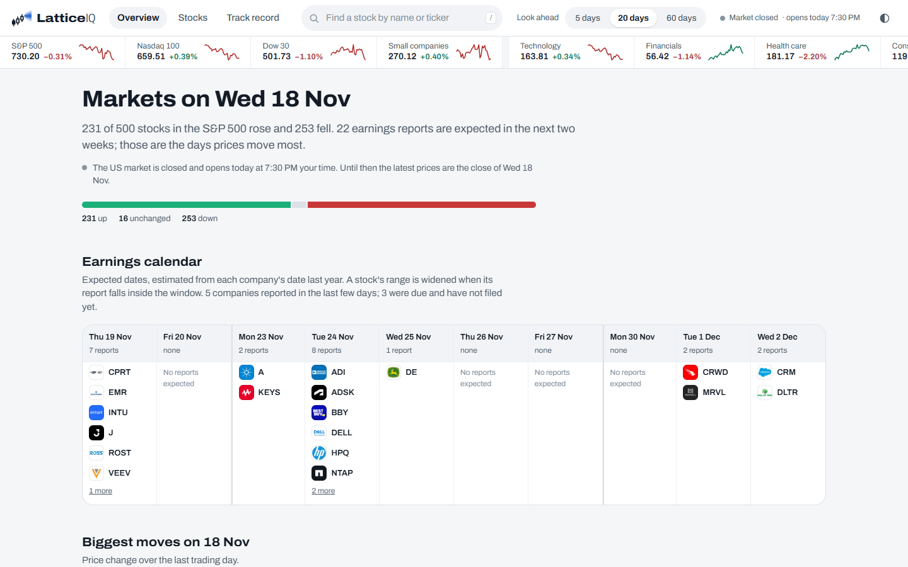</picture> | <picture>  <source media="(prefers-color-scheme: dark)" srcset="docs/assets/screen_record_dark.png">  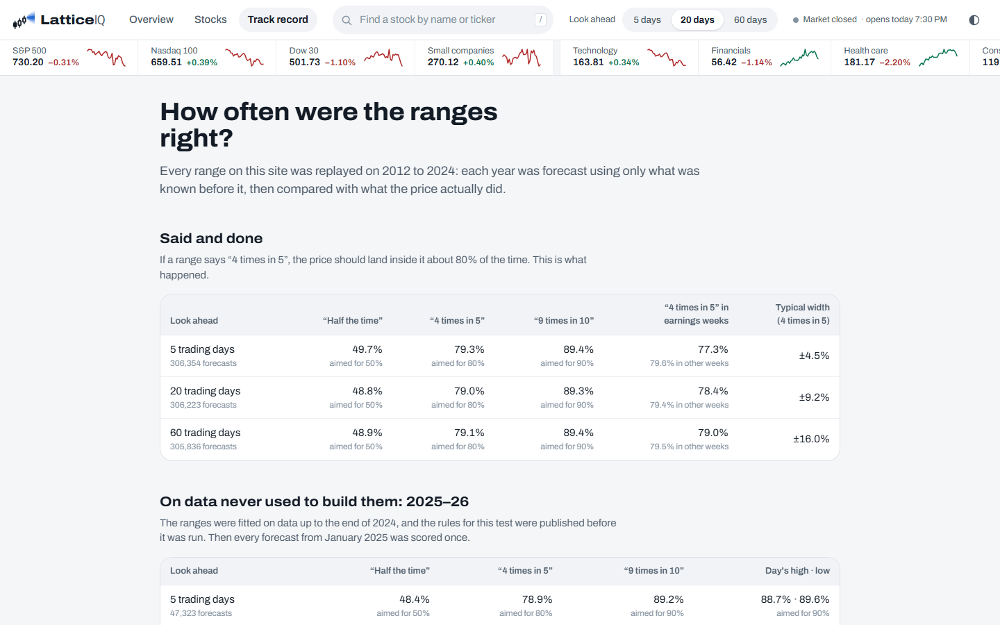</picture> |

<p align="center">
  <picture>
    <source media="(prefers-color-scheme: dark)" srcset="docs/assets/screen_phone_dark.png">
    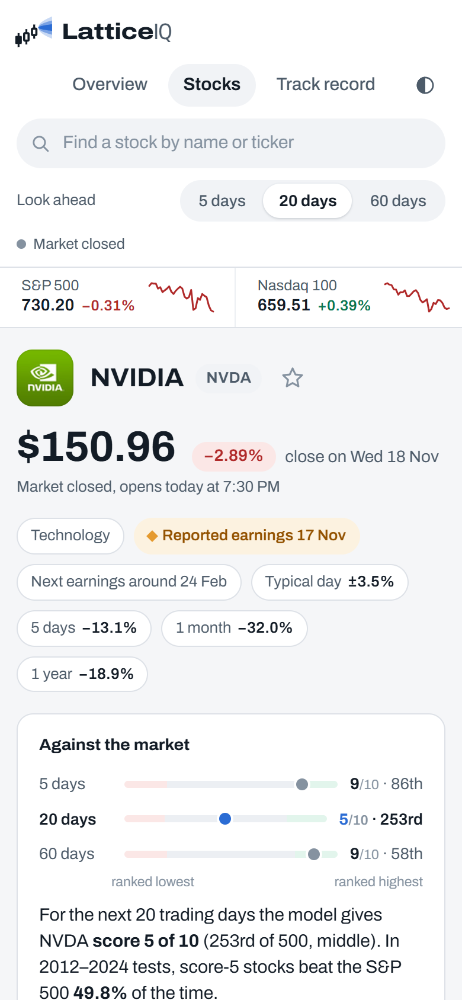
  </picture>
</p>

<sub>Screenshots of the live dashboard, taken with `python -m scripts.readme_shots`. They follow GitHub's light or dark theme. Prices and logos are shown as on the site; logos are trademarks of their owners.</sub>

### What the ranking was worth in testing

<picture>
  <source media="(prefers-color-scheme: dark)" srcset="docs/assets/rank_groups_dark.png">
  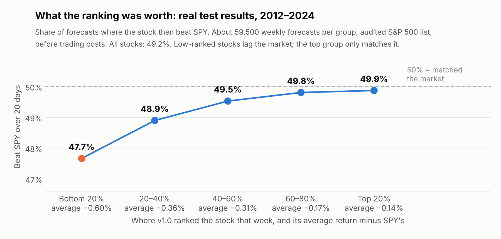
</picture>

<sub>Real results from run `20261114_0809` (file `results/20261114_0809_real_stock_h20_fund_sect/rank_groups_h20.csv`).</sub>

It does **not** give buy or sell calls, a probability that a stock goes up, an accuracy percentage or any profit figure. Each of those was either tested and failed or cannot be proven (see [what we claim](#what-we-claim-and-what-we-dont)).

## Results at a glance

Walk-forward backtest on the audited S&P 500 membership list: **722 stocks, test years 2012–2024, about 298,000 weekly forecasts**. For each test year the model is retrained only on earlier data, with a 60-day gap. The one-time 2025–26 holdout test of the ranking is running ([section below](#how-the-research-pipeline-works)).

| v1.0 neural net | 5 days | 20 days | 60 days |
|---|---|---|---|
| Direction vs the market right (coin flip = 50%) | 50.5% | **50.7%** | 51.0% |
| Rank IC (0 = no skill) | 0.0149 | **0.0197** | 0.0199 |
| t-statistic (above 2 = significant) | 3.07 | **3.18** | 2.23 |
| Years with positive rank IC | 12 of 13 | **10 of 13** | 10 of 13 |

<picture>
  <source media="(prefers-color-scheme: dark)" srcset="docs/assets/rank_ic_by_year_dark.png">
  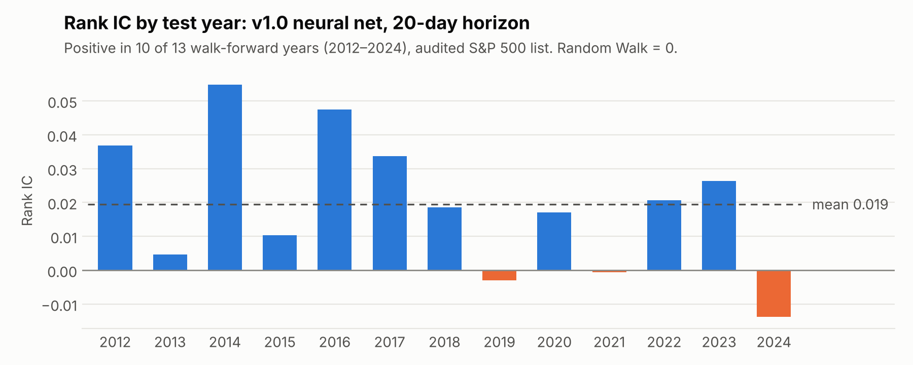
</picture>

**Reading these numbers.** The edge is small and statistically significant, and it survived a large data correction: on the earlier, wrong stock list the scores were 0.0136 / 0.0180 / 0.0229, so the 5- and 20-day results got slightly stronger on the true index and the 60-day result slightly weaker. At 20 days the forecasts also beat a "no change" forecast on error size (Diebold-Mariano p = 0.02). Weak points: 2019 and 2021 are about zero at 20 days, and **2024, the most recent test year, is negative at 20 and 60 days**. A check made while training the daily model points the same way: the edge has been thin since 2021 and clearly positive only at 5 days ([`docs/results.md`](docs/results.md), section 0c).

### What we claim, and what we don't

| Claim | Status | Evidence |
|---|---|---|
| The ranking has a small, significant edge that held in most of 13 test years | **Yes** | Table above |
| Low-ranked stocks tend to lag the market | **Yes** | Bottom 20% beat SPY only 47.7% of the time and trailed the top 20% by 0.46% per 20 days, in 11 of 13 years |
| The "4 times in 5" price range holds the price about 4 times in 5 | **Yes** | 79.3% / 79.0% / 79.1% at 5 / 20 / 60 days on 2012–2024 (about 306,000 forecasts per horizon); 78.9% / 78.1% / 77.8% on the unseen 2025–26 holdout, inside the 75–85% band set before the test |
| Top-ranked stocks beat the market | **No, not yet** | Top 20% beat SPY 49.9% of the time: they match it |
| We predict whether a stock will go up | **No** | Tested; lost to the plain historical rate, dropped |
| "X% accurate", or any return or profit figure | **No** | Not a provable claim; no trading strategy tested after costs |

Runs `20261114_0752/0809/0827` in [`results/`](results/). All tables: [`docs/results.md`](docs/results.md).

## Models: what we picked and what we dropped

One rule decided everything: a model or feature group stays only if it improves the rank IC on the walk-forward test years 2012–2024 in most years, not only on average. The 2025–26 holdout is never used to choose.

### In the product

| Job | Choice | Details | Measured |
|---|---|---|---|
| Rank stocks against the market | **Neural net, average of 3 seeds ("v1.0")** | Input 44 features → 64 → 32 → 1, ReLU, dropout 0.1, Adam, up to 8 passes with early stopping. One model per horizon. Features are ranked across stocks on each day. Target: return minus SPY's, extreme 1% clipped per day. Each forecast is multiplied by a trust factor *k* between 0 and 1, learned from the latest training years | Rank IC 0.0149 / 0.0197 / 0.0199, t 3.07 / 3.18 / 2.23 |
| Features | **Price and volume (17) + fundamentals (15) + sector (12)** | Momentum, reversal, volatility, beta; value, profitability, growth, earnings surprise from SEC filings; sector momentum and each stock's position inside its sector | Sectors gave the biggest single gain (0.0115 → 0.0140 on the early list) |
| Price ranges | **Volatility range model v2** | A regression forecasts each stock's volatility over the window (five volatility measures, the market's mood, expected earnings and the stock's typical earnings move); the range = price × exp(lower or upper multiplier × forecast × √days). Multipliers fitted on past windows, up and down separately, with separate ones when an earnings report is expected. 2–5% narrower than v1 at the same hit rate | 80% range held 79.3% / 79.0% / 79.1% on 2012–2024 and 78.9% / 78.1% / 77.8% on the 2025–26 holdout (pass); in earnings windows 77–79% (a one-size range: 57%) |
| Baseline | **Random Walk** (forecast = no excess return) | Every model must beat it | Rank IC 0 by construction |
| Second model for the holdout test | Ensemble of XGBoost + neural net, weighted by recent ranking skill | Declared before v1.0 was chosen, so both are scored once on the holdout | 0.0141 / 0.0173 / 0.0123 |

### Tested and dropped

| Tried | Result (20 days unless stated) | Why it is out |
|---|---|---|
| XGBoost as the main model | Rank IC 0.0067, t 0.86 on the audited list | Became unstable when the stock list grew; the neural net improved |
| LightGBM | 0.0080, t 1.00 | Ranks stocks 86% the same as XGBoost: a second vote for trees, no new information |
| Ridge (linear) | 0.0042, t 0.41 | Too simple; lowers any ensemble it joins |
| XGBoost ranking objective | 0.0080 vs 0.0140 for regression | Worse on the same features |
| Ensembles with three or four models | 0.0143, 0.0130 vs 0.0168 for two | Similar models outvote the different one |
| Macro features (VIX, yields, credit spread, CPI…) | 0.0118 vs 0.0128 price-only | Same value for every stock on a day, so it cannot help order them |
| Kronos-small, pretrained, alone | 0.0087, t 0.81, positive in 7 of 13 years | Weak and inconsistent; forecasts far too large |
| Kronos forecasts as extra features | 0.0147 vs 0.0140 | +0.0007 is noise (better in 6 years, worse in 5) and needs a daily GPU run |
| TimesFM 2.5, pretrained, alone | −0.0017, t −0.27 | No skill: its forecasts barely differ between stocks |
| TimesFM forecasts as extra features | 0.0128 vs 0.0140 | Makes the model worse |
| Probability that a stock goes up | Brier 0.2513 vs 0.2446 for the plain historical rate | Loses to "stocks rose 57% of the time"; removed from the product |
| Fine-tuning Kronos on US stocks | Not run | Published evidence shows little gain; finance-pretrained weights are tested instead |
| TabPFN-2.5, Moirai 2.0, TiRex | Not run | Licences do not allow commercial use, or are unclear |
| News from the direct Benzinga plan | About 2 articles a day market-wide | Too thin to compare stocks; replaced by Alpaca news (next row) |
| News sentiment (Alpaca news, 767,435 Benzinga articles from 2015, tone scored by FinBERT, 8 features) | +0.003 rank IC at 5 and 20 days on 2018–2024, paired t 1.29 / 0.83, worse in 3 of 7 years at 20 days | About as large as the difference between two runs of the same model; v1.0 stays (17 Nov) |

The comparisons from LightGBM down to TimesFM were run on the earlier 466- and 634-stock lists; the choice of the neural net was then re-measured on the audited list and held at all three horizons. Full record, including the data error found on 12 Nov 2026: [`docs/decisions.md`](docs/decisions.md).

**Why pretrained models lost.** Kronos and TimesFM see one stock's price history at a time. Our model compares all stocks on the same day and adds fundamentals and sector context, which is what "which stock beats the market" needs.

### Written, not yet measured on real data

| Item | What it is | Kept only if |
|---|---|---|
| Sector-neutral target | Learn "beat your own sector fund" instead of "beat SPY" | It beats v1.0 |
| Crash-risk model | Chance of a fall of more than 10% within 20 days | It beats a volatility-only model and is calibrated |
| Recovery model | After a crash, how often and how fast stocks got back to the old price | It beats the plain historical rate |
| Quantile XGBoost price ranges | The first range model; 79.8% / 80.3% / 80.2% on the earlier list | It beats the volatility range model on the audited list |
| ARIMA per stock | Classical baseline for the report | — |

Next candidates, not started: SEC 8-K events as inputs (the filings are already downloaded), a finance-pretrained forecaster (FinText Chronos), insider trading (SEC Form 4), short interest, option-implied volatility.

## System architecture

Four places run code: the PC (research downloads, experiments started from here), Kaggle (training and experiments on a free GPU), one AWS Lightsail server that runs the same daily program as the PC behind HTTPS (Caddy), and the browser (the dashboard). There is no database: data is kept in files.

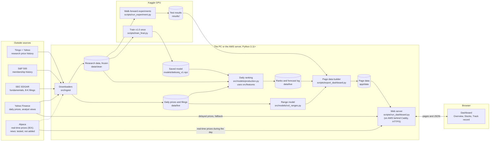

### Components

| # | Component | Code | Responsibility | Reads | Writes |
|---|---|---|---|---|---|
| 1 | Research downloaders | `src/ingest/tiingo.py`, `yahoo.py`, `edgar.py`, `sec_events.py`, `fred.py`, `alpaca_news.py` | Build the frozen research data once | Outside sources, `.env` keys | `data/raw/`, `data/clean/*.parquet` |
| 2 | Universe builder and audit | `scripts/build_universe.py`, `scripts/audit_universe.py`, `src/universe.py` | Who was in the S&P 500 on each day; reject price histories that belong to another company | Membership file, prices | `config/universe.csv` |
| 3 | Feature code | `src/features/`, `src/targets.py`, `src/data/clean.py` | Point-in-time features and targets on the trading calendar | Prices, fundamentals | In-memory panel (one row per stock per day) |
| 4 | Experiment runner | `scripts/run_experiment.py`, `src/folds.py`, `src/eval/metrics.py` | Walk-forward training and scoring of any model and feature set | Panel | `results/<run>/` |
| 5 | Kaggle job runner | `scripts/kaggle_cloud.py`, `kaggle/` | Upload data, start a GPU job, fetch its output | `data/clean/`, repo code | `results/`, `models/` |
| 6 | Daily model | `src/models/production.py`, `scripts/train_final.py`, `scripts/score_today.py` | Train v1.0 once and save it; rank every stock after each close with numpy only | `models/latticeiq_v1.npz`, research + daily prices, fundamentals | `data/live/rank.json`, `data/live/forecasts/<day>.csv` |
| 7 | Daily price update | `src/ingest/live.py`, `src/ingest/alpaca_live.py` | Latest closing prices (3 years); prices during the day in real time from IEX, or delayed from Yahoo; the market clock (holidays included, with Alpaca keys) | Yahoo, Alpaca | `data/live/prices.parquet` |
| 8 | Range model | `src/models/vol_ranges.py` | 50 / 80 / 90% price ranges for 5 / 20 / 60 days, earnings-aware, plus the last day's likely middle, high and low | Prices (stocks and SPY), filing dates | `data/live/range_fit.json` |
| 9 | Analyst views | `src/ingest/analysts.py` | Price targets and ratings for one stock, kept for a day, with a daily history | Yahoo | `data/live/analysts/<T>.json` |
| 10 | Page data builder | `scripts/export_dashboard.py` | Turn prices, ranges, ranks, filings and test results into the files the page reads | 6, 7, 8, filings, `results/` | `app/data/index.json`, `stocks/<T>.json`, `track.json` |
| 11 | Web server | `scripts/run_dashboard.py`; on AWS also `deploy/aws/` | Run updates on start and in the background; serve the page and three JSON endpoints; optional password | 6–10 | — |
| 12 | Dashboard | `app/index.html`, `app.js`, `styles.css` | Everything the user sees | Server, logo service | Browser storage (theme, starred stocks, chart choices) |

### The daily cycle

```mermaid
sequenceDiagram
    participant U as User
    participant S as Server (PC or AWS)
    participant Y as Yahoo / Alpaca
    participant E as SEC
    participant M as Saved model
    participant B as Dashboard page
    U->>S: start (once a day, or left running)
    S->>Y: closing prices, if a newer trading day exists
    S->>E: filings since the last check (once a day)
    S->>M: rank every stock for 5, 20, 60 days
    S->>S: build page data
    B->>S: load page and data
    loop while the US market is open
        B->>S: price of the stock on screen (every 2–3 s with IEX, 20 s with Yahoo)
        B->>S: all prices so far today (every 30 s)
        S->>Y: quotes for all stocks (IEX every 30 s; Yahoo every 10 min)
        B->>B: move the ranges to the price now
    end
    Note over S,B: About 20 minutes after the close the server downloads the finished day, ranks again, rebuilds the page data, and the page reloads itself
```

Two rules shape this design:

- **Train once, score daily.** One more day of data does not change what 25 years taught the model, so training runs monthly or quarterly on Kaggle and the PC only scores. The saved file holds plain arrays; the forward pass is a few lines of numpy, checked against PyTorch in a test.
- **One feature code path.** Daily scoring calls the same feature functions as the research code, on the research price history continued with the daily closing prices. On the test data this reproduces the research features exactly.

### Server interface

The server listens on `127.0.0.1:8600` only (this computer) unless started with `--host`, which needs a login. With `LATTICEIQ_PASSWORD` set, every request needs that password (HTTP Basic, any user name; 401 otherwise). On a server it sits behind Caddy, which adds HTTPS; the hosted site runs without a password. Every response carries `X-Robots-Tag: noindex` and `/robots.txt` disallows crawling. All responses are JSON except the page files.

| Request | Returns |
|---|---|
| `GET /` and files under `app/` | The dashboard page, scripts and `app/data/*.json` |
| `GET /api/today` | `state` (market open or not, next open or close, New York time), `quotes` for all stocks so far today, their `source` (IEX or Yahoo) and how often to ask again (`poll`), `fetched` time, `built` (changes when the page data is rebuilt, which tells the page to reload) |
| `GET /api/quote?t=NVDA` | Latest price for one stock (IEX real time, or Yahoo delayed): date, open, high, low, last, volume, previous close. Empty before the market opens. 404 for an unknown ticker |
| `GET /api/analysts?t=NVDA` | Price targets (low, mean, median, high), rating counts, last four earnings versus estimates |
| `GET /robots.txt` | Asks search engines not to crawl the site |

### Data files

Nothing here is committed to the repo: price and news data are licensed, and the files are rebuilt by the scripts.

| File | One row is | Main columns | Updated |
|---|---|---|---|
| `config/universe.csv` | A ticker's time in the index | ticker, type (stock / etf), start, end, source_ticker | On a rebuild (committed) |
| `data/clean/prices.parquet` | A stock on a trading day (4.2 million rows) | date, ticker, open, high, low, close, volume, adj_close, split_factor | Frozen ("universe v2") |
| `data/clean/fundamentals.parquet` | A reported value in an SEC filing (1.2 million) | ticker, item, start, end, val, filed, form | By `python -m src.ingest.edgar` |
| `data/clean/sec_events.parquet` | An 8-K filing (170,000) | ticker, filed, accepted (time), items, severity, one flag per event type | Frozen; newer filings in `sec_events_latest.parquet`, daily |
| `data/clean/news_articles.parquet`, `news_scored.parquet` | A news article; its sentiment score | id, created_utc, title, teaser, tickers, source; id, score | In testing |
| `data/live/prices.parquet` | A stock on a trading day, last 3 years | ticker, date, open, high, low, close, volume, adj_close | After every close, replaced in full |
| `models/latticeiq_v1.npz` | The saved model | Weights of 3 nets × 3 horizons, feature list, *k* per horizon, last training date | On retraining |
| `data/live/rank.json` | Today's ranking | asof, model, per stock and horizon: position, percentile, expected excess return | After every close |
| `data/live/forecasts/<day>.csv` | A stock's forecast made that day | asof, ticker, horizon, score, pct, pos, n, expected_excess, close | Appended daily, never changed |
| `data/live/range_fit.json` | Fitted range weights and multipliers, and the 2012–2024 replay | Per horizon: regression weights; lower and upper multiplier per level, earnings or not; the day's middle, high and low | When the range model or its data changes |
| `app/data/index.json`, `stocks/<T>.json`, `track.json` | What the page shows | Per stock: price, ranges, rank, candles, earnings, filings; test results by year | After every close |
| `results/<run>/` | One experiment | Settings, metrics by year, rank groups (predictions not committed) | Per experiment |

### Technology

| Layer | Used | Why |
|---|---|---|
| Language | Python 3.11+ (tests run on 3.12 in CI) | — |
| Data | pandas, NumPy, Parquet (pyarrow) | Files are enough at this size; no database to run |
| Models | PyTorch (neural net, training only), XGBoost and LightGBM (comparisons), NumPy (daily scoring) | Scoring on the PC needs no PyTorch |
| Training compute | Kaggle notebooks, T4 GPUs, driven from the PC | Free; the full training took 6 minutes on 16 Nov 2026 |
| Server | Python standard library `http.server`, one background thread; ranking in a separate process | No framework needed at this size |
| Hosting | AWS Lightsail, 1 GB, Sydney ($7 a month), Caddy for HTTPS, systemd service | Same program as on the PC; fits the budget |
| Dashboard | Plain HTML, CSS and JavaScript; TradingView Lightweight Charts 5.3 (bundled in `app/vendor`) | No build step |
| Tests | pytest, 52 tests, GitHub Actions on every push | Synthetic data, no keys needed |
| Settings and secrets | `config/settings.yaml`; API keys in `.env`, never committed | — |

More detail, including the evaluation rules and how each feature avoids look-ahead: [`docs/architecture.md`](docs/architecture.md).

## Requirements

Written from what the system does today, so they can be copied into an SRS. "Built" means working and tested; "Planned" means not started or not yet measured.

### Users

| User | Wants |
|---|---|
| Investor or student (viewer) | For a stock or the whole market: how it ranks, how far the price could move, what is scheduled, and how reliable those statements were in the past |
| Operator (maintainer) | To keep data current, retrain the model, run experiments and add data sources without breaking the tested results |

Outside systems: Yahoo Finance, SEC EDGAR, Tiingo, Alpaca, Kaggle, a logo service.

### Functional requirements

| ID | The system shall… | State |
|---|---|---|
| FR-1 | download the latest closing prices for every current S&P 500 member, 15 market and sector funds and former members that still trade, whenever a newer trading day exists | Built |
| FR-2 | show prices while the US market is open, with their source and whether the market is open: real time from IEX (the stock on screen every 2–3 seconds, all stocks every 30 seconds) or, without Alpaca keys, delayed from Yahoo (every 20 seconds and every 10 minutes) | Built |
| FR-3 | give, for each stock and for 5, 20 and 60 trading days, three price ranges (1 in 2, 4 in 5, 9 in 10), widened when an earnings report is expected inside the window, and for the last day the likely middle, a high it should stay below and a low it should stay above (each 9 times in 10) | Built |
| FR-4 | move the ranges with the price during the day, sized for the time left to the same end date, and show the range made at the close next to them | Built |
| FR-5 | rank every stock against the market for 5, 20 and 60 days after each close with the saved model, and show the position, a score from 1 to 10, the expected return versus SPY and how often stocks with that score beat SPY in testing | Built |
| FR-6 | write every day's forecasts to a dated log before their outcomes are known | Built |
| FR-7 | list SEC 8-K filings by event type and importance for each stock and for the market, refreshed once a day | Built |
| FR-8 | show past earnings days, the next expected earnings date and a two-week earnings calendar | Built |
| FR-9 | show analysts' 12-month price targets, rating counts and earnings versus estimates, labelled as opinions that are not tested | Built |
| FR-10 | draw a price chart (line or candles, 1 week to 1 year, volume, the range cone ahead, earnings marks, past top- and bottom-fifth calls with their outcome, values on pointing, full-window view) | Built |
| FR-11 | let the user search by name or ticker, star stocks, sort (including by model rank) and filter to "earnings soon" | Built |
| FR-12 | show a market overview: how many stocks rose and fell, biggest moves, calmest and wildest stocks, highest and lowest ranked, important filings | Built |
| FR-13 | show a track record page: every range replayed on 2012–2024, said versus done by year, the 2025–26 holdout result, the record of each score, and what the site can and cannot tell | Built |
| FR-14 | open with the data already on disk when there is no internet or an outside source fails | Built |
| FR-15 | train the model once on all data with a known outcome, save it, and allow retraining with one command | Built |
| FR-16 | run any model and feature set through the same walk-forward test and record the settings and results | Built |
| FR-17 | audit the stock list against the price data after every rebuild | Built |
| FR-18 | score the logged daily forecasts against what happened and show a live record | Planned |
| FR-19 | add news sentiment, SEC event features, crash risk and recovery odds, each only after it passes its test | Planned |
| FR-20 | answer questions about a stock in a chat, using the model's forecast and never the language model's own guess | Planned |
| FR-21 | run as a hosted website over HTTPS, with an optional shared password | Built |
| FR-22 | offer per-person accounts and an API | Planned |

### Quality requirements

| ID | Requirement | How it is met or checked |
|---|---|---|
| NFR-1 | **No look-ahead.** A feature on day *t* uses only what was public by the close of *t* | Filing dates, first-filed values, index membership on that day, news after 4 pm counted for the next day; 52 automated tests, including "random data must show no skill" and "a planted signal must be found" |
| NFR-2 | **Honest evaluation.** Every published number comes from the walk-forward test or the locked holdout | 60-day gap between training and test; same weekly dates for every model; holdout from 1 Jan 2025 excluded in code |
| NFR-3 | **Honest wording.** No buy or sell calls, no accuracy percentage, no profit figure; "not investment advice" on the page | Track record page; claims table above |
| NFR-4 | **Speed.** Price update about a minute; ranking under a minute; page data about 10 seconds; price on screen 2–3 seconds old with IEX (with Yahoo: up to 20 seconds plus its delay of up to 15 minutes) | Measured on the development PC |
| NFR-5 | **Keeps working.** A failed download never stops the dashboard; old prices are kept if most tickers fail; a failing analyst request affects only its card | Handled in `run_dashboard.py`, `live.py`, `analysts.py`; tests |
| NFR-6 | **Same result twice.** Fixed random seeds, settings in one file, research data frozen, each run saved with its settings | `config/settings.yaml`, `results/` |
| NFR-7 | **Safe to host.** On the PC the server accepts connections from this computer only; on a server everything travels over HTTPS, a password is optional, and search engines are asked not to list the site; no accounts and no personal data; API keys only in `.env` | `127.0.0.1` binding; refuses `--host` without a password; Caddy HTTPS; noindex header and robots.txt; `.gitignore`; login test |
| NFR-8 | **Runs on an ordinary PC.** Daily use needs no GPU and no PyTorch | NumPy scoring from saved weights |
| NFR-9 | **Easy to change safely.** One feature code path for research and daily use; tests on every push | GitHub Actions |
| NFR-10 | **Usable.** Light and dark themes, works at laptop and phone widths, keyboard search and stepping | Checked by screenshot at several sizes |

### Limits and assumptions

- S&P 500 stocks only; US regular market hours. Market holidays are known only with Alpaca keys (Alpaca's market clock); without them the system finds no new prices on a holiday and waits.
- Free data: Yahoo and Tiingo prices are for research and personal use; Yahoo's prices during the day can be delayed by up to 15 minutes; IEX prices come from one exchange (a small share of US trading) and its volume is not the day's volume. A commercial launch needs a licensed feed keyed by a permanent security ID.
- The sentiment scorer under test (FinBERT) is non-commercial; logos are trademarks loaded from an outside service, not stored.
- No per-person accounts (the site is open or behind one shared password), no mobile app. The hosted version is one server with no standby copy.
- Fundamentals are as of the last download; a weekly refresh is not automated yet.
- The intraday ranges are the closing ranges re-centred, not a separately tested model.

## How the research pipeline works

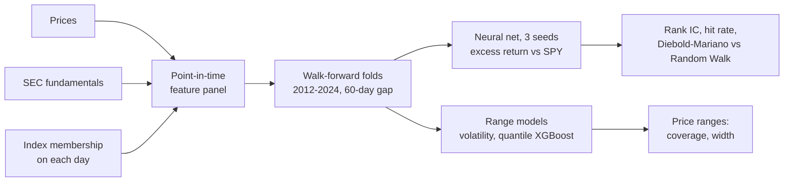

For each test year the model is trained on all earlier years, minus a 60-trading-day gap so that no training target overlaps the test year. Inside each training period the most recent part is held back as a validation set; validation and test scores are close (20 days: 0.020 vs 0.020; 5 days: 0.016 vs 0.015; 60 days: 0.023 vs 0.020), so the model is not just memorising. The **2025–26 holdout** was used once, after the model was final, under rules written before the run ([`docs/holdout-lock.md`](docs/holdout-lock.md)): the price ranges passed every pre-set band (80% range held 78.9% / 78.1% / 77.8%); the ranking run is in progress and will be published whatever it shows. The daily model learns from every date with a known outcome, including 2025–26, but that period is never used to test or choose anything: the holdout test will train its own model on data to 2024.

### Data honesty

On 12 Nov 2026 a bug was found: the stock list had been frozen at the January 2019 index membership. It was fixed, the list rebuilt, and every price history audited against the index ([`scripts/audit_universe.py`](scripts/audit_universe.py)).

- **Coverage of the true index:** 81% → 98% of members have prices in the test years (average 91%); 67% in the early training years. Missing stocks are mostly companies that were taken over or failed, so early years lean towards survivors.
- **Wrong-company histories:** free data keyed by ticker symbol shows a reused symbol's history as the latest owner's. The audit found six such cases (one inside the test years) by comparing each stock's trading volume with other index members; all are removed.
- Details: [`docs/data-sources.md`](docs/data-sources.md), [`docs/decisions.md`](docs/decisions.md).

## How it compares with the market

No credible tool claims to call direction right 90% of the time. Commercial AI stock pickers advertise backtested returns of their top picks or self-reported win rates; published research reports 51–52%.

| Who | Published figure | How it is measured |
|---|---|---|
| Danelfin | Top-scored stocks +14.69% a year vs the S&P 500; strategy +376% vs +166% (2017–2025) | Top group only; backtest |
| Prospero.ai | 54% win rate vs the S&P 500, about 5,000 picks | Self-reported |
| AltIndex | 70% win rate, 22% average gain over six months | Self-reported, no benchmark |
| Research (finance-pretrained models, 2025) | 51.74% direction accuracy, next day | All US stocks; published study |
| **LatticeIQ v1.0** | **50.7% direction, rank IC 0.020 (t 3.18), 20 days** | **Every stock, every week, 13 walk-forward years, S&P 500 only** |

The numbers are not directly comparable: marketing figures cover top picks in a rising market, ours cover every stock in every test year. Measured their way, our top group only matches the market today, and that is the main thing to improve. Full table, sources and a checklist for reading any accuracy claim: [`docs/market-comparison.md`](docs/market-comparison.md).

## More results

<picture>
  <source media="(prefers-color-scheme: dark)" srcset="docs/assets/ablation_dark.png">
  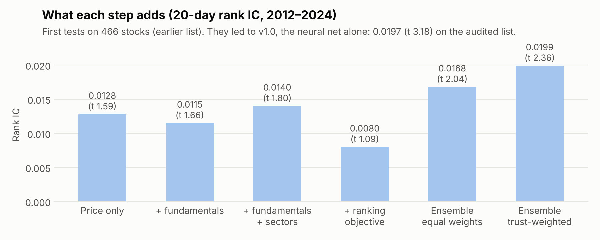
</picture>

| Model, 20 days, audited list (722 stocks) | Hit rate | Rank IC | t-stat |
|---|---|---|---|
| Random Walk (baseline) | 50.0% | 0 | — |
| XGBoost | 50.5% | 0.0067 | 0.86 |
| Ensemble (XGBoost + neural net, weighted by recent skill) | 50.5% | 0.0173 | 2.34 |
| **Neural net, 3 seeds (v1.0)** | **50.7%** | **0.0197** | **3.18** |

<picture>
  <source media="(prefers-color-scheme: dark)" srcset="docs/assets/bracket_coverage_dark.png">
  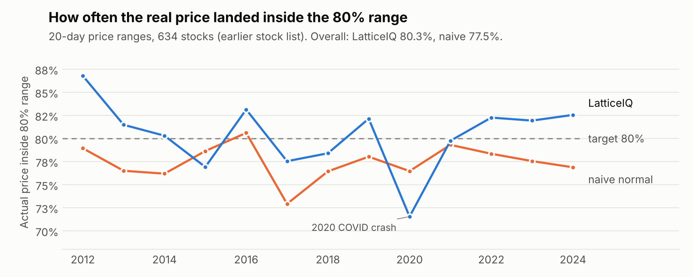
</picture>

<picture>
  <source media="(prefers-color-scheme: dark)" srcset="docs/assets/horizons_dark.png">
  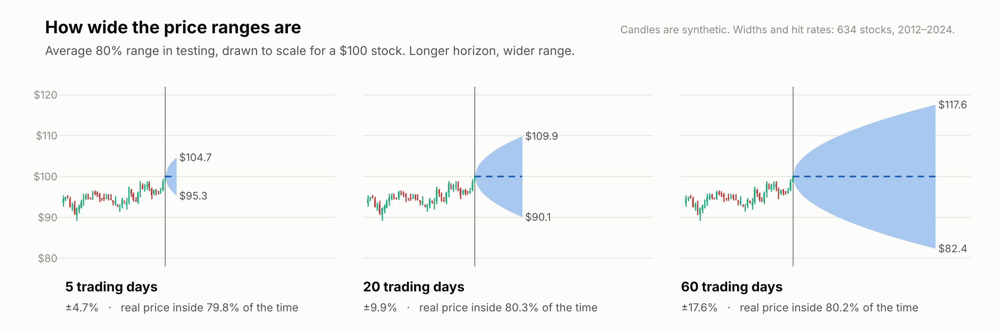
</picture>

**Price ranges.** The two charts above show the first range model (quantile XGBoost, earlier 634-stock list): its 80% range held 79.8% / 80.3% / 80.2% of the time at 5 / 20 / 60 days (naive normal model: 79.3% / 77.5% / 76.5%). The volatility range model now in the dashboard (v2, 17 Nov) held 79.3% / 79.0% / 79.1% on 2012–2024 with an average width of 9.1% / 18.5% / 32.0% of the price, 2–5% narrower than v1 (79.5% / 79.0% / 79.1%), and 77–79% in earnings weeks where a one-size range holds only 57%. On the unseen 2025–26 data it held 78.9% / 78.1% / 77.8% and passed every band set before the test ([`docs/results.md`](docs/results.md), section 8a). A side-by-side run of v2 and quantile XGBoost on the audited list is still to do.

A rank IC of 0.01–0.05 is typical for honest stock forecasting. All tables and limitations: [`docs/results.md`](docs/results.md).

## Quick start

```bash
git clone https://github.com/Naveed-CoLab/LatticeX.git
cd LatticeX
python -m venv .venv
.venv\Scripts\activate            # Windows cmd  (PowerShell: .venv\Scripts\Activate.ps1, macOS/Linux: source .venv/bin/activate)
pip install -r requirements.txt
pytest -q                          # 52 tests, ~5 minutes, no data or keys needed
```

Try the full pipeline on synthetic data (no keys needed):

```bash
python -m scripts.run_experiment --data synthetic --signal none        # must show NO skill
python -m scripts.run_experiment --data synthetic --signal momentum    # must find the planted signal
python -m scripts.run_brackets  --data synthetic --signal volcluster
```

Real data needs API keys in `.env` (copy `.env.example`, check with `python -m scripts.check_keys`). How to download and rebuild the data: [`data/README.md`](data/README.md). After any rebuild run `python -m scripts.audit_universe`. Heavy jobs run on Kaggle's free GPUs: [`docs/kaggle-workflow.md`](docs/kaggle-workflow.md).

## Daily use

```bash
python -m scripts.kaggle_cloud final-model   # once (repeat monthly or quarterly): train v1.0 on all data, save models/latticeiq_v1.npz
python -m scripts.run_dashboard              # every day: prices update, the saved model ranks every stock, http://localhost:8600 opens
```

Each start downloads the latest closing prices (about a minute, only when a newer trading day exists), checks the SEC for new filings once a day, ranks every stock and builds the page. Left running, it shows today's prices while the US market is open and rolls the forecasts forward by itself after the close. Double-click `start_dashboard.bat` to run it in a minimised window. Every day's ranks are also written to `data/live/forecasts/`, so each forecast is on record before its outcome is known.

| Page | What it shows |
|---|---|
| Overview | How many stocks rose and fell, a two-week earnings calendar, the day's biggest moves, the calmest and wildest stocks for the chosen look-ahead, the highest and lowest ranked stocks, important SEC filings |
| Stocks | Any S&P 500 stock: today's price, the model's score against the market, the likely price range in 5, 20 and 60 trading days, a chart with the range cone ahead, earnings marks and past calls, recent filings, and what analysts expect in 12 months. Search by name or ticker, star stocks, sort by rank, filter by sector, move, rank and range |
| Track record | Every range replayed on 2012–2024 and scored on the unseen 2025–26 data, the record of each score, and what the site can and cannot tell you |

Details of every part of the page: [`app/README.md`](app/README.md).

**On a server.** The same program runs on one small AWS Lightsail server (about $7 a month) behind HTTPS, with no login since 19 Nov (a password can be switched back on in `.env`): `deploy/aws/setup.sh` installs it, and [`deploy/aws/README.md`](deploy/aws/README.md) has the steps. The free price data is licensed for personal or research use, so the site asks search engines not to list it, and a licensed feed comes before promoting it.

## Repository layout

```
LatticeX/
├── config/            settings.yaml (horizons, folds, model settings) + stock list with S&P 500 membership dates
├── src/
│   ├── ingest/        downloaders: Tiingo and Yahoo prices, daily prices (live), real-time prices (alpaca_live),
│   │                  analyst views, SEC fundamentals, SEC 8-K events, FRED, news (Alpaca)
│   ├── data/          calendar alignment, synthetic test data
│   ├── features/      price, fundamentals, sector (in the model); macro, news, pretrained forecasts (tested)
│   ├── models/        production (daily model), vol_ranges (price ranges), neural net and ensemble, XGBoost,
│   │                  Random Walk, ARIMA, Kronos and TimesFM runners
│   ├── news/          sentiment scoring
│   ├── eval/          metrics: hit rate, rank IC + Newey-West t, Diebold-Mariano
│   ├── targets.py     future excess return vs SPY
│   ├── folds.py       walk-forward folds with gap, holdout lock
│   └── universe.py    point-in-time S&P 500 membership
├── scripts/           run_experiment, run_brackets, run_crash_risk, run_recovery, kaggle_cloud,
│                      build_universe, audit_universe, check_keys,
│                      train_final (train the daily model), score_today (rank today's stocks),
│                      export_dashboard (build page data), run_dashboard (web server),
│                      holdout_ranges (one-time range test), rank_scores (record of each score),
│                      readme_shots (screenshots for this README)
├── app/               the dashboard (plain HTML, CSS and JavaScript; page data built locally, not committed)
├── kaggle/            code that runs inside Kaggle notebooks
├── deploy/aws/        put the dashboard on an AWS server: setup script, service, HTTPS, data upload
├── tests/             leakage and correctness tests (run on every push by GitHub Actions)
├── results/           experiment summaries (metrics CSV/JSON; predictions are not committed)
├── data/              not committed: rebuilt by the download scripts (see data/README.md)
├── models/            not committed: trained models (see models/README.md)
└── docs/              project flow, methodology, architecture, data sources, results, decisions, holdout lock,
                       market comparison, progress log
```

| Doc | Use it for |
|---|---|
| [`docs/project-flow.md`](docs/project-flow.md) | **Start here.** The project step by step: what was done, why, the result, the evidence, and what is next |
| [`docs/methodology.md`](docs/methodology.md) | **The methods in plain words, with the published research behind each one** (38 references) |
| [`docs/architecture.md`](docs/architecture.md) | Design detail: pipeline, evaluation rules, look-ahead rules, daily model, range model, server |
| [`docs/decisions.md`](docs/decisions.md) | **Which models and features are in or out, and why**; data errors found and fixed; product decisions |
| [`docs/results.md`](docs/results.md) | All results tables and limitations |
| [`docs/holdout-lock.md`](docs/holdout-lock.md) | The rules of the one-time 2025–26 test, written before it was run, and its run log |
| [`docs/data-sources.md`](docs/data-sources.md) | Every data source, licence, coverage of the real index, known gaps |
| [`docs/market-comparison.md`](docs/market-comparison.md) | What competitors and research claim, and how we compare |
| [`docs/kaggle-workflow.md`](docs/kaggle-workflow.md) | Running jobs on Kaggle GPUs from a PC |
| [`app/README.md`](app/README.md) | The dashboard in detail |
| [`deploy/aws/README.md`](deploy/aws/README.md) | Putting the dashboard on an AWS server, step by step |
| [`docs/PROGRESS.md`](docs/PROGRESS.md) | What is done, TODO, work log |
| [`CONTRIBUTING.md`](CONTRIBUTING.md) | Rules for changes, branches, commits |

## Roadmap

- **Now:** the ranking's one-time 2025–26 holdout result, then the report and presentation (by 28 Nov).
- **Next:** live record from the daily forecast log, weekly refresh of fundamentals, monthly retraining. Model ideas, each kept only if it beats v1.0 on the same test years: insider purchases (SEC Form 4), SEC 8-K events as inputs, sector-neutral target, a finance-pretrained model (FinText), crash-risk and recovery models, adaptive range calibration. News sentiment was tested and not added (17 Nov).
- **Before a launch:** licensed price data keyed by a permanent security ID (free data is research-only), a commercially licensed sentiment model, per-person accounts, legal review of every performance statement.

## Glossary

| Term | Meaning |
|---|---|
| Excess return | A stock's return minus SPY's (the S&P 500 fund) over the same days |
| Horizon | How far ahead a forecast looks: 5, 20 or 60 trading days |
| Rank IC | How well the predicted order of stocks matched the real order on each date, averaged. 0 = no skill; 0.01–0.05 is typical for honest stock forecasting |
| t-statistic | How sure we are the rank IC is not zero; about 2 or more counts as significant |
| Hit rate | Share of forecasts with the right direction against the market; 50% is a coin flip |
| Walk-forward test | Train on the past, test on the next year, move one year forward, repeat |
| Gap (embargo) | 60 trading days left out between training and test so no outcome overlaps |
| Holdout | 2025–26: kept untouched for one final test |
| Universe v2 | The audited list of S&P 500 members since 2000 with their price histories (722 stocks) |
| Point-in-time | Using only what was known on that day |
| Trust factor *k* | A number from 0 to 1 that scales each forecast by how well the model did on its latest training years |
| Coverage | How often the real price ended inside a range; an 80% range should score about 80% |
| 8-K | The SEC form a company files when something important happens |

## Licence

Code: [MIT](LICENSE). Data is **not** included: Tiingo, Yahoo, Alpaca (IEX prices, Benzinga news) and other providers have their own terms. Pretrained models keep their licences (Kronos MIT, TimesFM Apache 2.0; FinBERT is used for research only).
