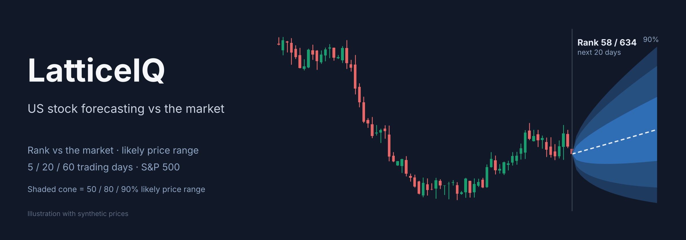
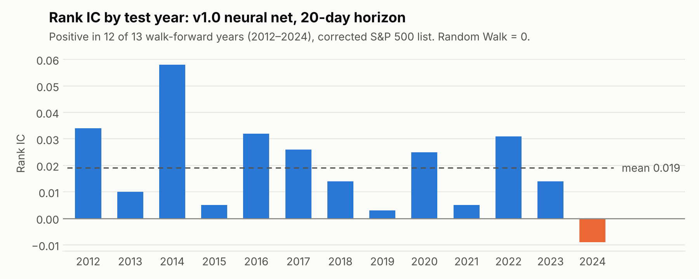
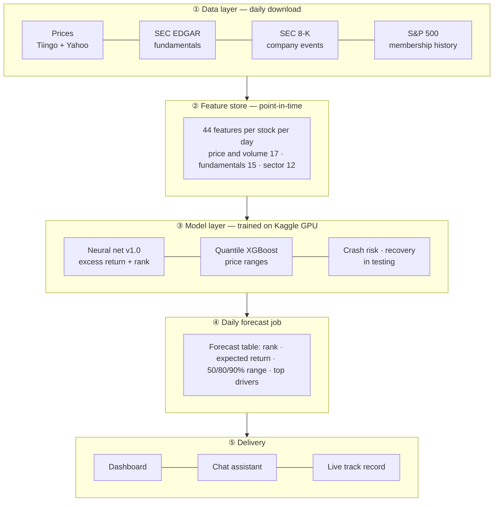
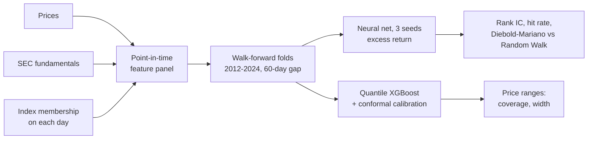
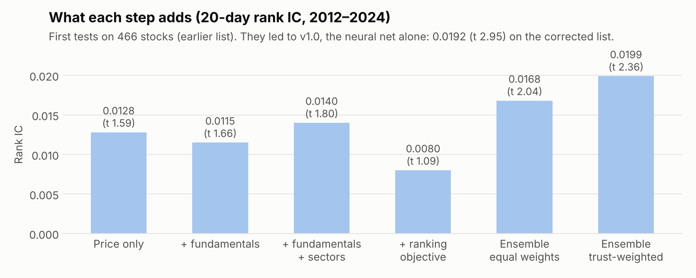
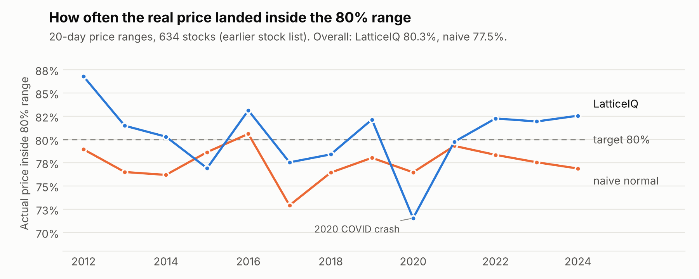

<p align="center">
  
</p>

<p align="center">
  <b>How do S&P 500 stocks rank against the market over the next 5, 20 and 60 trading days, and how far could each price move?</b>
</p>

<p align="center">
  <a href="https://github.com/Naveed-CoLab/LatticeX/actions/workflows/tests.yml"></a>
  
  
  
  
  
  
</p>

<p align="center">
  <a href="#what-it-does">What it does</a> ·
  <a href="#results-at-a-glance">Results</a> ·
  <a href="#how-it-compares-with-the-market">Market comparison</a> ·
  <a href="#app-structure">App structure</a> ·
  <a href="#quick-start">Quick start</a> ·
  <a href="docs/PROGRESS.md">Progress</a>
</p>

A university final-year project (2026), built to become a product. Architecture and methods: [`docs/architecture.md`](docs/architecture.md).

> **Not investment advice.** This is a research project. All results are historical backtests, and no return or profit claim is made.

---

## What it does

For every S&P 500 stock on a given day, LatticeIQ produces:

| Output | Meaning |
|---|---|
| **Excess-return forecast and rank** | Expected return vs SPY over 5 / 20 / 60 trading days, and where the stock ranks against the others |
| **Price ranges** | 50% / 80% / 90% likely price ranges, calibrated so the 80% range really contains the price about 80% of the time |
| **Track record for that rank** | How stocks ranked like this one actually did against SPY in testing |
| **Crash risk · recovery odds** *(in testing)* | Chance of a 10%+ drop in 20 days; after a crash, chance of getting back to the old price |
| **Official company news** *(in testing)* | SEC 8-K events (earnings, restatements, executive changes…) as a live feed |
| **Drivers** | Which features pushed the forecast |

## Results at a glance

Walk-forward backtest on the corrected S&P 500 membership list: **727 stocks, test years 2012–2024, about 298,000 weekly forecasts**. For each test year the model is retrained only on earlier data, with a 60-day gap. The 2025–26 holdout is still locked.

| v1.0 neural net | 5 days | 20 days | 60 days |
|---|---|---|---|
| Direction vs the market right (coin flip = 50%) | 50.4% | **50.6%** | 51.0% |
| Rank IC (0 = no skill) | 0.0141 | **0.0192** | 0.0202 |
| t-statistic (above 2 = significant) | 2.84 | **2.95** | 2.23 |
| Years with positive rank IC | 11 of 13 | **12 of 13** | 9 of 13 |

<picture>
  <source media="(prefers-color-scheme: dark)" srcset="docs/assets/rank_ic_by_year_dark.png">
  
</picture>

**Reading these numbers.** The edge is small and statistically significant. It did not come from a data error: on the earlier, wrong stock list (see below) the scores were 0.0136 / 0.0180 / 0.0229, so the 5- and 20-day results got slightly stronger on the true index and the 60-day result slightly weaker. The most recent test year, 2024, is negative at 20 and 60 days.

### What we claim, and what we don't

| Claim | Status | Evidence |
|---|---|---|
| The ranking has a small, significant edge that held in most of 13 test years | **Yes** | Table above |
| The 90% price range contains the real price about 90% of the time | **Yes** | 90.0% / 90.4% / 90.8% at 5 / 20 / 60 days¹ |
| Low-ranked stocks tend to lag the market | **Yes** | Bottom 20% beat SPY only 48.0% of the time (20 days)¹ |
| Top-ranked stocks beat the market | **No, not yet** | Top 20% beat SPY 49.9% of the time¹: they match it |
| We predict whether a stock will go up | **No** | Tested; lost to the plain historical rate, dropped |
| "X% accurate", or any return or profit figure | **No** | Not a provable claim; no trading strategy tested after costs |

<sub>¹ Measured on the earlier 634-stock list; the re-run on the corrected list is in progress.</sub>

Numbers shown here are from runs `20261113_1855/1914/1932` (in [`results/`](results/)), made before six wrong-company price histories were removed in the data audit of 13 Nov 2026. The final "universe v2" run replaces them; full history in [`docs/decisions.md`](docs/decisions.md).

## How it compares with the market

No credible tool claims to call direction right 90% of the time. Commercial AI stock pickers advertise backtested returns of their top picks or self-reported win rates; published research reports 51–52%.

| Who | Published figure | How it is measured |
|---|---|---|
| Danelfin | Top-scored stocks +14.69% a year vs the S&P 500; strategy +376% vs +166% (2017–2025) | Top group only; backtest |
| Prospero.ai | 54% win rate vs the S&P 500, about 5,000 picks | Self-reported |
| AltIndex | 70% win rate, 22% average gain over six months | Self-reported, no benchmark |
| Research (finance-pretrained models, 2025) | 51.74% direction accuracy, next day | All US stocks; published study |
| **LatticeIQ v1.0** | **50.6% direction, rank IC 0.019 (t 2.95), 20 days** | **Every stock, every week, 13 walk-forward years, S&P 500 only** |

The numbers are not directly comparable: marketing figures cover top picks in a rising market, ours cover every stock in every test year. Measured their way, our top group only matches the market today, and that is the main thing to improve. Full table, sources and a checklist for reading any accuracy claim: [`docs/market-comparison.md`](docs/market-comparison.md).

## App structure



| Layer | Code | Status |
|---|---|---|
| ① Data | `src/ingest/`, `scripts/build_universe.py`, `scripts/audit_universe.py` | ✅ prices, fundamentals, 8-K events, audited stock list · ⏸ news |
| ② Features | `src/features/` | ✅ 44 features, leakage-tested · ⏳ 8-K event features |
| ③ Models | `src/models/`, `scripts/run_experiment.py`, `scripts/run_brackets.py` | ✅ v1.0 neural net, price ranges · ⏳ crash risk, recovery |
| ④ Forecast job | `scripts/forecast_today.py` | ⏳ next |
| ⑤ Dashboard / chat | `app/` | ⏳ next |

Tested and left out because they did not help: economy-wide (macro) features, Kronos and TimesFM pretrained forecasts, a ranking objective, LightGBM, ridge, and an XGBoost + neural-net ensemble. Reasons and numbers: [`docs/decisions.md`](docs/decisions.md).

### What one forecast looks like

```json
{
  "date": "2024-12-18", "ticker": "EXAMPLE", "horizon_days": 20,
  "expected_excess_return_vs_spy": 0.012,
  "rank_percentile": 0.91,
  "rank_group": "top 20%",
  "rank_group_history": "beat SPY 49.9% of the time; bottom 20%: 48.0%",
  "price_range": { "50%": [101.2, 107.9], "80%": [97.6, 111.8], "90%": [95.3, 114.6] },
  "top_drivers": ["12-month momentum", "free-cash-flow yield", "sector momentum"]
}
```
<sub>Illustrative example of the output format, not a real forecast.</sub>

## How it works



**No look-ahead** is the key design rule: every feature on date *t* uses only information public by the close of *t* (filing dates, data revision dates, index membership on that day). 33 automated tests check this, including "random data must show no skill" and "a planted signal must be found". Inside each training period the most recent part is held back as a validation set; validation and test scores are close (20 days: 0.021 vs 0.019), so the model is not just memorising. The **2025–26 holdout is locked** and will be run once, when the model is final.

### Data honesty

On 12 Nov 2026 a bug was found: the stock list had been frozen at the January 2019 index membership. It was fixed, the list rebuilt, and every price history audited against the index ([`scripts/audit_universe.py`](scripts/audit_universe.py)).

- **Coverage of the true index:** 81% → 98% of members have prices in the test years (average 91%); 67% in the early training years. Missing stocks are mostly companies that were taken over or failed, so early years lean towards survivors.
- **Wrong-company histories:** free data keyed by ticker symbol shows a reused symbol's history as the latest owner's. The audit found six such cases (one inside the test years) by comparing each stock's trading volume with other index members; all are removed.
- Details: [`docs/data-sources.md`](docs/data-sources.md), [`docs/decisions.md`](docs/decisions.md).

## More results

<picture>
  <source media="(prefers-color-scheme: dark)" srcset="docs/assets/ablation_dark.png">
  
</picture>

| Model, 20 days, corrected list (727 stocks) | Hit rate | Rank IC | t-stat |
|---|---|---|---|
| Random Walk (baseline) | 50.0% | 0 | — |
| XGBoost | 50.5% | 0.0086 | 1.11 |
| Ensemble (XGBoost + neural net, trust-weighted) | 50.5% | 0.0175 | 2.30 |
| **Neural net, 3 seeds (v1.0)** | **50.6%** | **0.0192** | **2.95** |

<picture>
  <source media="(prefers-color-scheme: dark)" srcset="docs/assets/bracket_coverage_dark.png">
  
</picture>

**Price ranges** (earlier 634-stock list): the 80% range contained the real price 79.8% / 80.3% / 80.2% of the time at 5 / 20 / 60 days (naive normal model: 79.3% / 77.5% / 76.5%), and the 90% range 90.0% / 90.4% / 90.8% (naive: 87.5% / 86.6% / 86.0%).

A rank IC of 0.01–0.05 is typical for honest stock forecasting. All tables and limitations: [`docs/results.md`](docs/results.md).

## Quick start

```bash
git clone https://github.com/Naveed-CoLab/LatticeX.git
cd LatticeX
python -m venv .venv
.venv\Scripts\activate            # Windows cmd  (PowerShell: .venv\Scripts\Activate.ps1, macOS/Linux: source .venv/bin/activate)
pip install -r requirements.txt
pytest -q                          # 33 tests, ~4 minutes, no data or keys needed
```

Try the full pipeline on synthetic data (no keys needed):

```bash
python -m scripts.run_experiment --data synthetic --signal none        # must show NO skill
python -m scripts.run_experiment --data synthetic --signal momentum    # must find the planted signal
python -m scripts.run_brackets  --data synthetic --signal volcluster
```

Real data needs API keys in `.env` (copy `.env.example`, check with `python -m scripts.check_keys`). How to download and rebuild the data: [`data/README.md`](data/README.md). After any rebuild run `python -m scripts.audit_universe`. Heavy jobs run on Kaggle's free GPUs: [`docs/kaggle-workflow.md`](docs/kaggle-workflow.md).

## Repository layout

```
LatticeX/
├── config/            settings.yaml (horizons, folds, model params) + stock universe with S&P 500 membership dates
├── src/
│   ├── ingest/        downloaders: Tiingo and Yahoo prices, SEC EDGAR fundamentals, SEC 8-K events, FRED, Benzinga
│   ├── data/          calendar alignment, synthetic test data
│   ├── features/      price, fundamentals, sector (in the model); macro, news, pretrained forecasts (tested)
│   ├── models/        Random Walk, XGBoost, neural net and ensemble, Kronos and TimesFM runners
│   ├── eval/          metrics: hit rate, rank IC + Newey-West t, Diebold-Mariano
│   ├── targets.py     future excess return vs SPY
│   ├── folds.py       walk-forward folds with gap, holdout lock
│   └── universe.py    point-in-time S&P 500 membership
├── scripts/           run_experiment, run_brackets, run_crash_risk, run_recovery, kaggle_cloud,
│                      build_universe, audit_universe, check_keys
├── kaggle/            code that runs inside Kaggle notebooks
├── tests/             leakage and correctness tests (run on every push by GitHub Actions)
├── results/           experiment summaries (metrics CSV/JSON; predictions are not committed)
├── data/              not committed: rebuilt by the download scripts (see data/README.md)
├── models/            not committed: trained models (see models/README.md)
└── docs/              architecture, data sources, results, decisions, market comparison, progress log
```

| Doc | For whom |
|---|---|
| [`docs/architecture.md`](docs/architecture.md) | How the pipeline fits together, leakage rules |
| [`docs/data-sources.md`](docs/data-sources.md) | Every data source, licence, coverage of the real index, known gaps |
| [`docs/decisions.md`](docs/decisions.md) | **Which models and features are in or out, and why**; data errors found and fixed |
| [`docs/results.md`](docs/results.md) | All results tables and limitations |
| [`docs/market-comparison.md`](docs/market-comparison.md) | What competitors and research claim, and how we compare |
| [`docs/kaggle-workflow.md`](docs/kaggle-workflow.md) | Running jobs on Kaggle GPUs from a PC |
| [`docs/PROGRESS.md`](docs/PROGRESS.md) | What is done, TODO, work log |
| [`CONTRIBUTING.md`](CONTRIBUTING.md) | Rules for changes, branches, commits |

## Roadmap

- **Now:** final v1.0 run and price ranges on the audited stock list; crash-risk and recovery models; SEC 8-K event features; a finance-pretrained model (FinText) as an extra input; sector-neutral target. Each is kept only if it beats v1.0 on the same test years.
- **Next:** daily forecast job, dashboard, chat assistant, live track record, one-time 2025–26 holdout test.
- **Before a launch:** licensed price data keyed by a permanent security ID (free data is research-only), legal review of every performance statement.

## Licence

Code: [MIT](LICENSE). Data is **not** included: Tiingo, Yahoo, Benzinga and other providers have their own terms. Pretrained models keep their licences (Kronos MIT, TimesFM Apache 2.0; FinBERT is used for research only).
