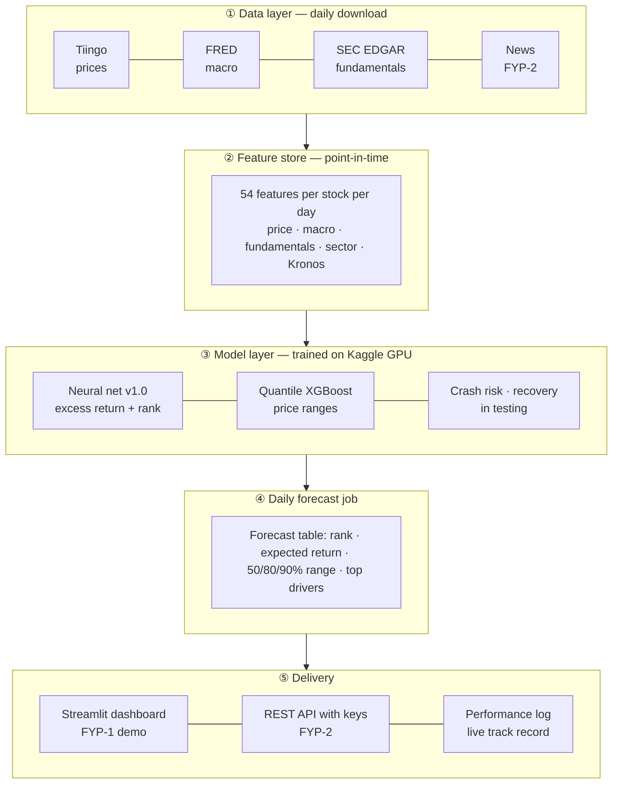
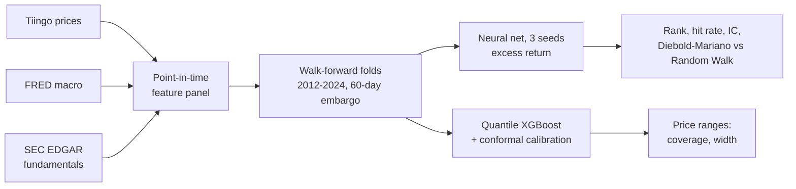

<p align="center">
  
</p>

<p align="center">
  <b>How do S&P 500 stocks rank against the market over the next 5, 20 and 60 trading days, and how far could each price move?</b>
</p>

<p align="center">
  <a href="https://github.com/Naveed-CoLab/LatticeX/actions/workflows/tests.yml"></a>
  
  
  
  
  
  
</p>

<p align="center">
  <a href="#what-it-does">What it does</a> ·
  <a href="#app-structure">App structure</a> ·
  <a href="#results">Results</a> ·
  <a href="#quick-start">Quick start</a> ·
  <a href="#repository-layout">Layout</a> ·
  <a href="docs/PROGRESS.md">Progress</a>
</p>

Final Year Project (FYP-1, 2026). Architecture and methods: [`docs/architecture.md`](docs/architecture.md).

> **Not investment advice.** This is a research project. All results are historical backtests.

---

## What it does

For every S&P 500 stock on a given day, LatticeIQ produces:

| Output | Meaning |
|---|---|
| **Excess-return forecast and rank** | Expected return vs SPY over 5 / 20 / 60 trading days, and where the stock ranks against the others |
| **Price brackets** | 50% / 80% / 90% likely price ranges, calibrated so the 80% range really contains the price about 80% of the time |
| **Track record for that rank** | How stocks ranked like this one actually did against SPY in testing |
| **Crash risk · recovery odds** *(in testing)* | Chance of a 10%+ drop in 20 days; after a crash, chance of getting back to the old price |
| **Official company news** *(in testing)* | SEC 8-K events (earnings, restatements, executive changes…) as a live feed |
| **Drivers** | Which features pushed the forecast (feature importance) |

## App structure

LatticeIQ is built in layers. FYP-1 delivers the research core and a demo dashboard; FYP-2 turns it into a deployed product with an API.



| Layer | Code | Status |
|---|---|---|
| ① Data | `src/ingest/` | ✅ prices, macro, fundamentals · ⏸ news |
| ② Features | `src/features/` | ✅ 54 features, leakage-tested |
| ③ Models | `src/models/`, `scripts/run_experiment.py`, `scripts/run_brackets.py` | ✅ v1.0 neural net locked, price ranges · ⏳ crash risk, recovery, 8-K events (Kronos, TimesFM, XGBoost ensemble tested and dropped) |
| ④ Forecast job | `scripts/forecast_today.py` | ⏳ FYP-1 |
| ⑤ Dashboard / API | `app/` | ⏳ dashboard FYP-1 · API FYP-2 |

### What one forecast looks like

```json
{
  "date": "2024-12-18", "ticker": "EXAMPLE", "horizon_days": 20,
  "expected_excess_return_vs_spy": 0.012,
  "rank_percentile": 0.91,
  "rank_group": "top 20%",
  "rank_group_history": "beat SPY 49.9% of the time; bottom 20%: 48.0%",
  "price_range": { "50%": [101.2, 107.9], "80%": [97.6, 111.8], "90%": [95.3, 114.6] },
  "top_drivers": ["12-month momentum", "free-cash-flow yield", "sector momentum"]
}
```
<sub>Illustrative example of the output format, not a real forecast.</sub>

## How it works



The key design rule is **no look-ahead**: every feature on date *t* uses only information public by the close of *t* (filing dates, data revision dates, index membership on that day). 19 automated tests check this, including a "random data must show no skill" test and a "planted signal must be found" test. The **2025–26 holdout is locked** and will be used once, at the end of FYP-2.

More detail: [`docs/architecture.md`](docs/architecture.md).

## Results

Walk-forward backtest (first 466, then the full 634 S&P 500 stocks), test years 2012–2024, scored weekly (208,000–280,000 stock-dates). The 2025–26 holdout is still locked.

<picture>
  <source media="(prefers-color-scheme: dark)" srcset="docs/assets/ablation_dark.png">
  
</picture>

| Setup (20-day horizon) | Hit rate | Rank IC | IC t-stat |
|---|---|---|---|
| Random Walk (baseline) | 50.0% | 0 | — |
| XGBoost, price features | 50.4% | 0.0128 | 1.59 |
| + fundamentals | 50.7% | 0.0115 | 1.66 |
| + fundamentals + sectors | 50.7% | 0.0140 | 1.80 |
| + ranking objective | 50.3% | 0.0080 | 1.09 |
| Ensemble: XGBoost + neural net, equal weights | 50.5% | 0.0168 | 2.04 |
| **Ensemble, trust-weighted (final)** | **50.6%** | **0.0199** | **2.36** |
| **v1.0 locked — neural net (3 seeds), full 634 stocks, 20-day** | **50.6%** | **0.0180** | **2.66** |
| v1.0, 5-day / 60-day | 50.5% / 51.3% | 0.0136 / 0.0229 | 2.63 / 2.39 |

<picture>
  <source media="(prefers-color-scheme: dark)" srcset="docs/assets/rank_ic_by_year_dark.png">
  
</picture>

**Price ranges are well calibrated at every horizon** (634 stocks): the 80% range contained the real price 79.8% / 80.3% / 80.2% of the time at 5 / 20 / 60 days (naive normal model: 79.3% / 77.5% / 76.5%), and the 90% range 90.0% / 90.4% / 90.8% (naive: 87.5% / 86.6% / 86.0%).

**What the ranking skill means in plain numbers** (20-day, v1.0): stocks the model ranked in the bottom 20% trailed its top 20% by 0.4% per 20 days on average, in 12 of 13 years; they beat SPY 48.0% of the time versus 49.9% for the top 20%. The model is better at flagging likely laggards than at finding big winners. The "probability up" from the range model did not beat the plain historical rate and is not used.

<picture>
  <source media="(prefers-color-scheme: dark)" srcset="docs/assets/bracket_coverage_dark.png">
  
</picture>

A rank IC of 0.01–0.05 is typical for honest stock forecasting. Full tables, 5- and 60-day results and limitations: [`docs/results.md`](docs/results.md). What was kept or dropped and why: [`docs/decisions.md`](docs/decisions.md).

## Quick start

```bash
git clone https://github.com/Naveed-CoLab/LatticeX.git
cd LatticeX
python -m venv .venv
.venv\Scripts\activate            # Windows cmd  (PowerShell: .venv\Scripts\Activate.ps1, macOS/Linux: source .venv/bin/activate)
pip install -r requirements.txt
pytest -q                          # 19 tests, ~2 minutes, no data or keys needed
```

Try the full pipeline on synthetic data (no keys needed):

```bash
python -m scripts.run_experiment --data synthetic --signal none        # must show NO skill
python -m scripts.run_experiment --data synthetic --signal momentum    # must find the planted signal
python -m scripts.run_brackets  --data synthetic --signal volcluster
```

Real data needs API keys in `.env` (copy `.env.example`, check with `python -m scripts.check_keys`). How to download and rebuild the data: [`data/README.md`](data/README.md). Heavy jobs run on Kaggle's free GPUs: [`docs/kaggle-workflow.md`](docs/kaggle-workflow.md).

## Repository layout

```
LatticeX/
├── config/            settings.yaml (horizons, folds, model params) + stock universe with S&P 500 membership dates
├── src/
│   ├── ingest/        downloaders: Tiingo prices, FRED macro, SEC EDGAR fundamentals, Benzinga news
│   ├── data/          calendar alignment, synthetic test data
│   ├── features/      price, macro, fundamentals, sector, news, Kronos features (all point-in-time)
│   ├── models/        Random Walk, ARIMA, XGBoost, Kronos runner
│   ├── news/          FinBERT sentiment scoring
│   ├── eval/          metrics: hit rate, rank IC + Newey-West t, Diebold-Mariano
│   ├── targets.py     future excess return vs SPY
│   ├── folds.py       walk-forward folds with embargo, holdout lock
│   └── universe.py    point-in-time S&P 500 membership
├── scripts/           entry points: run_experiment, run_brackets, kaggle_cloud, build_universe, check_keys
├── kaggle/            code that runs inside Kaggle notebooks (FinBERT)
├── tests/             leakage and correctness tests (run on every push by GitHub Actions)
├── results/           experiment summaries (metrics CSV/JSON; predictions are not committed)
├── data/              not committed: rebuilt by the download scripts (see data/README.md)
├── models/            not committed: trained models (see models/README.md)
└── docs/              architecture, data sources, results, progress log, assets/ (README images)
```

| Doc | For whom |
|---|---|
| [`docs/architecture.md`](docs/architecture.md) | How the pipeline fits together, leakage rules |
| [`docs/data-sources.md`](docs/data-sources.md) | Every data source, licence, point-in-time handling, known gaps |
| [`docs/decisions.md`](docs/decisions.md) | **Which models and features are in or out, and why** |
| [`docs/results.md`](docs/results.md) | All results tables and limitations |
| [`docs/kaggle-workflow.md`](docs/kaggle-workflow.md) | Running jobs on Kaggle GPUs from a PC |
| [`docs/PROGRESS.md`](docs/PROGRESS.md) | What is done, TODO, decisions, work log |
| [`CONTRIBUTING.md`](CONTRIBUTING.md) | Rules for changes, branches, commits |

## Roadmap

- **FYP-1 (Nov 2026):** Kronos and TimesFM comparison, ARIMA baseline, final model locked, daily forecast job, Streamlit dashboard, report.
- **FYP-2 (2027):** full ~680-stock universe, Kronos fine-tuned on US stocks, news sentiment at scale, ensemble, REST API with keys, deployment, one-time 2025–26 holdout test.

## Licence

Code: [MIT](LICENSE). Data is **not** included: Tiingo, Benzinga and other providers have their own terms. Pretrained models keep their licences (Kronos MIT, TimesFM Apache 2.0; FinBERT is used for research only).
