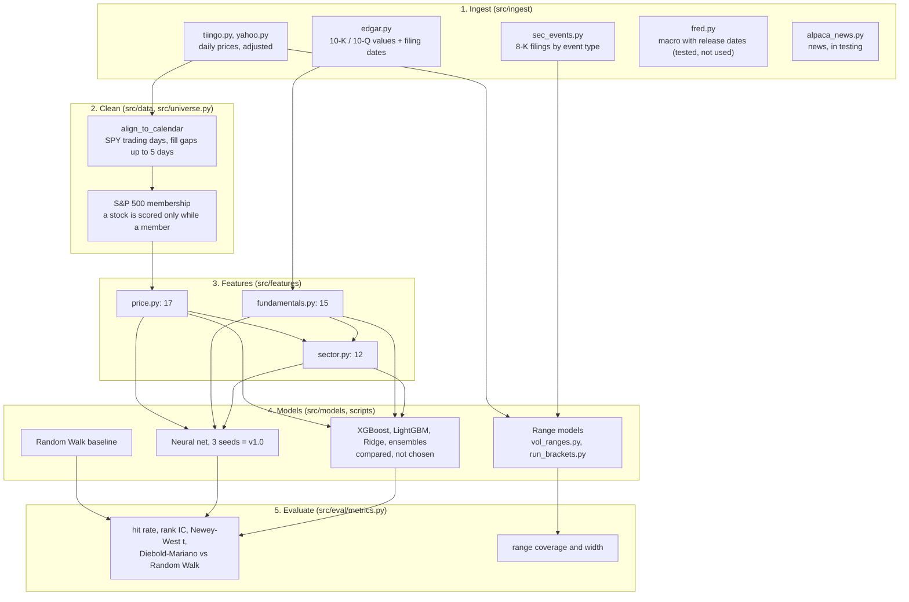

# Architecture

How LatticeIQ turns raw data into forecasts, how it serves them every day, and how it avoids fooling itself. The overview, the component table, the server interface and the list of data files are in the main [`README`](../README.md#system-architecture); this page holds the design detail behind them. The methods explained in plain words, with the research behind each, are in [`methodology.md`](methodology.md).

Contents: [Two halves](#two-halves-of-the-system) · [Research pipeline](#research-pipeline) · [Targets](#targets) · [Features](#features) · [Ranking model v1.0](#ranking-model-v10) · [Evaluation rules](#evaluation-rules) · [Point-in-time rules](#point-in-time-rules-no-look-ahead) · [Price ranges](#price-ranges) · [Daily model](#daily-model-train-once-score-daily) · [Daily prices](#daily-prices) · [Local server](#local-server) · [Dashboard](#dashboard) · [Failure handling](#failure-handling) · [Compute](#compute)

## Two halves of the system

| | Research half | Daily half |
|---|---|---|
| Purpose | Decide which model and features work, and prove it | Serve the chosen model every day |
| Data | Frozen files in `data/clean/` ("universe v2", prices to 5 Nov 2026) | `data/live/`: three years of closing prices, replaced after every close |
| Runs | On Kaggle's GPU, started from the PC | On the PC |
| Models | Retrained inside every test year, never saved | One saved file, `models/latticeiq_v1.npz` |
| Output | `results/<run>/` | `data/live/rank.json`, `app/data/*.json`, the dashboard |

The research data is frozen on purpose: updating it in place would change the data the published results were measured on. The daily half therefore keeps its own small price file and joins it to the research history only in memory, when scoring.

## Research pipeline

## Targets

`src/targets.py` builds, for each stock and date *t*:

- `y_h`: log return of the stock minus log return of SPY from the close of *t* to the close of *t + h* (h = 5, 20, 60 trading days)
- `beat_h`: 1 if `y_h > 0`
- `fret_h`: the stock's own future log return (used for price ranges)

Targets are clipped at the 1st and 99th percentile per date before training; metrics are always computed on the raw values.

## Features

44 inputs per stock per day. Each is turned into a rank across all stocks on that day (−0.5 to +0.5), which removes market-wide shifts. A missing value becomes 0, the middle rank.

| Group | Count | Names | Source |
|---|---|---|---|
| Price and volume | 17 | Returns over 5, 20, 60, 120, 252 days; 12-month momentum skipping the last month; return minus SPY over 20 and 60 days; volatility over 20 and 60 days and their ratio; distance from the 50- and 200-day average; unusual volume; RSI; beta and stock-specific volatility over 60 days | `src/features/price.py` |
| Fundamentals | 15 | Value: earnings, sales, free-cash-flow yield, book to market. Quality: return on equity, gross profitability, operating margin, accruals, leverage. Growth: revenue, assets. Earnings: unexpected earnings, days since the last filing, price reaction to the last filing. Size | `src/features/fundamentals.py` |
| Sector | 12 | Momentum of the stock's sector fund over 20 and 60 days; the stock's rank inside its sector on 10 of the features above | `src/features/sector.py` |

Sectors come from prices alone: each month-end a stock is assigned to the sector fund (XLK, XLF, XLE…) its returns followed most closely over the past year after removing the market move. No outside classification is needed and the label is known on that date.

Tested and not used: macro (8, `macro.py`), Kronos forecasts (2) and TimesFM forecasts (3) (`pretrained.py`). In testing: news (8, `news.py`). Reasons and numbers: [`decisions.md`](decisions.md).

## Ranking model v1.0

| Item | Value |
|---|---|
| Type | Feed-forward neural net (PyTorch), `MLPSeeds` in `src/models/ensemble.py` |
| Shape | 44 inputs → 64 → 32 → 1 output, ReLU, dropout 0.1 |
| Training | Adam, learning rate 0.001, weight decay 0.00001, batches of 4,096, squared error on the standardised target, up to 8 passes; the latest 10% of training dates are held back and training stops when their error stops improving |
| Seeds | Three nets that differ only in their random start (42, 43, 44); the forecast is their average |
| Horizons | One model each for 5, 20 and 60 trading days |
| Trust factor *k* | `fit_shrunk` in `scripts/run_experiment.py`: a copy is trained on the first 80% of the training dates and checked on the rest (after a 60-day gap); *k* is the slope of real outcome on forecast, kept between 0 and 1. Final forecast = *k* × the forecast of a model trained on all training dates. With no skill, *k* goes to 0 and the forecast falls back to "no excess return" |
| Output | Expected excess return vs SPY per stock; stocks are ordered by it |

## Evaluation rules

| Rule | Where |
|---|---|
| Walk-forward: train on all years before the test year, test one calendar year, 2012 → 2024 | `src/folds.py` |
| 60-trading-day gap between the last training date and the first test date (at least the longest horizon, so no target overlaps) | `config/settings.yaml` |
| Every model is scored on the same weekly date grid (`eval_step: 5`) | `src/folds.py:eval_dates` |
| Holdout from 2025-01-01 is excluded everywhere until the model is final | `holdout_start` in settings |
| Rank IC t-statistics use Newey-West standard errors (targets overlap) | `src/eval/metrics.py` |
| Model vs Random Walk compared with Diebold-Mariano + HLN correction | `src/eval/metrics.py` |
| An add-on counts only if it beats v1.0 by clearly more than chance (two near-identical runs differ by 0.0005–0.0008 over 13 years and up to 0.015 in a single year), in most years, in the same Kaggle job | [`results.md`](results.md), section 0 |

## Point-in-time rules (no look-ahead)

| Data | Rule |
|---|---|
| Prices | Features on *t* use closes up to *t*; targets start at *t + 1* |
| Index membership | A stock is in the universe on *t* only if it was an S&P 500 member on *t* |
| Fundamentals (EDGAR) | First-filed value only (no restatements), usable from the day after the filing date, dropped after 450 days without a filing |
| Sectors | Assigned at the previous month-end from past prices only |
| 8-K events | Time-stamped by the SEC's acceptance time to the second |
| News | Articles at or after 4 pm New York count for the next trading day |
| Macro (FRED) | Each value usable only from its release date (ALFRED vintages); market series the next day |
| Kronos, TimesFM | Forecast made at *t* from data up to *t*, carried forward at most 31 days, never backwards |

Each rule has a test in `tests/test_pipeline.py` (43 tests). The two key sanity tests:

- **Random data → no skill.** On pure noise the model must show a rank IC t-statistic near 0. A "win" here means leakage.
- **Planted signal → found.** On data with a built-in momentum effect, the model must find it (t > 3).

## Price ranges

### Volatility range model (in the dashboard): `src/models/vol_ranges.py`

1. **Daily volatility** per stock: a blend of four measures (based on each day's high-low range, 60-day, 250-day, and one weighted towards recent days).
2. **Range** for a look-ahead of *H* trading days: `low, high = price × exp(∓ q × daily_vol × √H)`.
3. **The multiplier *q*** is not assumed from a bell curve: for each look-ahead and level (50%, 80%, 90%) it is the value that would have held the price that share of the time on earlier windows. It is fitted separately for windows with an expected earnings report, where stocks move about 1.7 times more.
4. **Expected earnings date:** last year's earnings 8-K date plus 364 days (same weekday); it counts if it falls within 3 days of the window.
5. For the dashboard the multipliers are fitted on windows that ended by 31 Dec 2024 and cached in `data/live/range_fit.json`.

**During the day** the page re-centres the range made at the last close on the price now and sizes it for the time left to the same end date: half-width × √(days left ÷ *H*). This is not a separately tested model; the track record describes ranges made at the close.

### Quantile XGBoost + conformal calibration (first model, comparison pending): `scripts/run_brackets.py`

1. Scale each stock's future return by its recent volatility.
2. Quantile XGBoost predicts the 5 / 10 / 25 / 50 / 75 / 90 / 95% quantiles.
3. Conformal calibration on the previous years widens or narrows the ranges so that 80% ranges hold about 80% of the time.
4. Scored against a naive normal-volatility baseline: coverage, width, pinball loss.

The probability that a stock goes up, read off this model, lost to the plain historical rate and was removed.

## Daily model: train once, score daily

Code: `src/models/production.py`; commands `scripts/train_final.py` and `scripts/score_today.py`.

**Training** (`python -m scripts.kaggle_cloud final-model`, 6 minutes on a Kaggle GPU on 16 Nov 2026, about 8 GB of memory):

1. Build the same panel as the research code (price + fundamentals + sector features) on all research data.
2. For each horizon run the v1.0 recipe (`fit_shrunk`) on every date whose outcome is known.
3. Export the three nets per horizon as plain arrays and save them with a description: feature list, *k* and rows per horizon, last date learned from, creation time.
4. Check that the saved copy gives the same forecasts as the PyTorch model (difference below 0.0001; measured about 0.000000001).

**Scoring** (after every close, under a minute, no PyTorch):

1. Join each ticker's research price history to the daily prices at the last day both have (`splice`). The two sources adjust prices on different scales, so the adjusted price continues at the research scale; a split since the freeze (closes differ by more than 5% on the joining day) is recorded so market value stays right.
2. Build today's features with the research feature functions (`build_panel` with the joined prices), using every filing.
3. Take the latest day for which most members have a price, run the numpy forward pass, multiply by *k*.
4. Write `data/live/rank.json` (per stock and horizon: position, percentile, expected excess return) and add `data/live/forecasts/<day>.csv`.

Checked on the test data: research prices cut three weeks early and continued from a differently scaled daily file gave identical scores (difference 0.0).

Retraining monthly or quarterly is enough; the server notices a new model file and ranks again. The daily model learns from 2025–26 as well, but that period is never used to test or choose anything: the holdout test trains its own model on data to 2024.

## Daily prices

`src/ingest/live.py`, source Yahoo Finance.

| Rule | Detail |
|---|---|
| Which tickers | Current members, 15 market and sector funds, and former members that still traded at the freeze (the model's price features are ranks across all of them, as in training) |
| How much | Three years, replaced in full on every update, so splits and dividends stay consistent |
| When a day counts as finished | 16:20 New York time on a weekday; an unfinished day is never written to the file |
| When to download | When the file's last day is older than the last finished day; after a check that found nothing newer (a holiday), not again for 3 hours |
| Today so far | `quotes()` returns only bars after the last finished day: open, high, low, last, volume, previous close. Delayed by up to 15 minutes |
| Market hours | 9:30 to 16:00 New York, Monday to Friday; holidays are not known |

## Local server

`scripts/run_dashboard.py`: Python's standard `http.server` on `127.0.0.1:8600`, one background thread.

**On start:** update prices → update SEC filings (at most once in 20 hours) → rank with the saved model (only if prices or the model are newer than the last ranking) → rebuild the page data if any input is newer than it → start the background thread → open the browser. Each step is allowed to fail; the server then opens with the data on disk. `--no-update` skips all downloads.

**Background thread (every minute):**

- market open: fetch today's prices for all stocks every 10 minutes;
- last finished day newer than the file (checked at most every 30 minutes): download it, rank again, rebuild the page data, clear the day's quotes.

**Endpoints:** `/api/today`, `/api/quote?t=`, `/api/analysts?t=` (see the README). `/api/quote` fetches one stock at most every 20 seconds. `/api/today` includes the time the page data was built; when it changes, the page reloads. Responses are never cached.

## Dashboard

`app/`: plain HTML, CSS and JavaScript, no build step. TradingView Lightweight Charts 5.3 and the font are bundled in `app/vendor`.

| Part | Design |
|---|---|
| Pages | Overview, Stocks, Track record, switched by the address after `#` |
| Data | `app/data/index.json` (one row per stock) on load; `app/data/stocks/<T>.json` when a stock is opened; `track.json` for the track record |
| Live prices | Asks `/api/today` every 30 seconds and `/api/quote` for the open stock every 20 seconds; repaints the price, the ranges, the cone and the ladder |
| Chart | Line or candles, volume, a custom cone drawing for the three ranges, marks for the period's high and low and for earnings days |
| Kept in the browser | Theme, starred stocks, chart type, volume on or off (`localStorage`); nothing is sent anywhere |
| Logos | Loaded by the browser from an outside logo service by company web address; never stored in the project |
| Layout | One scrolling page with a fixed stock list and side panel on wide screens; single column on phones; light and dark themes |

Details of each card: [`../app/README.md`](../app/README.md).

## Failure handling

| What fails | What happens |
|---|---|
| No internet, or Yahoo / SEC not answering at start | A message is printed and the dashboard opens with the data on disk |
| Most tickers fail in a price update | The old price file is kept |
| A few tickers fail | They are listed; the rest is saved |
| The saved model is missing | Ranges and prices work; the rank panel says how to train the model |
| Ranking fails after a close | The page keeps its ranges; the error is printed and tried again later |
| Analyst data missing for a stock | Only that card says so; the last saved copy is used if there is one |
| A background update raises an error | It is printed and tried again a minute later; the server keeps running |

## Compute

Data downloads, daily scoring and the dashboard run on a laptop. GPU jobs (training, walk-forward experiments, Kronos, TimesFM, sentiment scoring) run on Kaggle through `scripts/kaggle_cloud.py`: it uploads `data/clean/` as a private dataset, pushes the repo code as a notebook, waits, and downloads the output. See [`kaggle-workflow.md`](kaggle-workflow.md).
