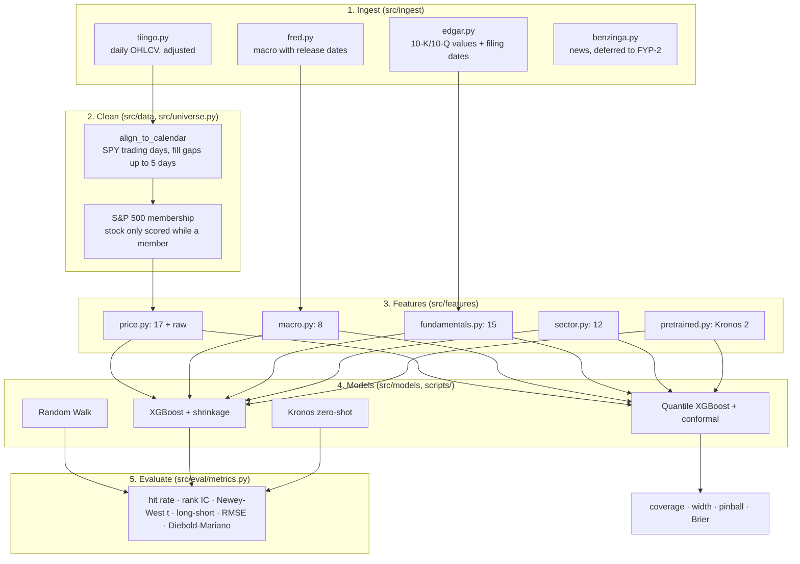

# Architecture

How LatticeIQ turns raw data into forecasts, and how it avoids fooling itself.

## Pipeline

## Targets

`src/targets.py` builds, for each stock and date *t*:

- `y_h`: log return of the stock minus log return of SPY from the close of *t* to the close of *t + h* (h = 5, 20, 60 trading days)
- `beat_h`: 1 if `y_h > 0`
- `fret_h`: the stock's own future log return (used for price brackets)

Targets are winsorised at 1% / 99% per date before training; metrics are always computed on the raw values.

## Evaluation protocol

| Rule | Where |
|---|---|
| Walk-forward: train on all years before the test year, test one calendar year, 2012 → 2024 | `src/folds.py` |
| 60-trading-day embargo between the last training date and the first test date (≥ longest horizon, so no target overlaps) | `config/settings.yaml` |
| Every model is scored on the same weekly date grid (`eval_step: 5`) | `src/folds.py:eval_dates` |
| Holdout from 2025-01-01 is excluded everywhere until the end of FYP-2 | `holdout_start` in settings |
| Rank IC t-stats use Newey-West standard errors (overlapping targets) | `src/eval/metrics.py` |
| Model vs Random Walk compared with Diebold-Mariano + HLN correction | `src/eval/metrics.py` |

## Point-in-time rules (no look-ahead)

| Data | Rule |
|---|---|
| Prices | Features on *t* use closes up to *t*; targets start at *t + 1* |
| Index membership | A stock is in the universe on *t* only if it was an S&P 500 member on *t* |
| Macro (FRED) | Each value is usable only from its release date (ALFRED vintages); market series the next day |
| Fundamentals (EDGAR) | First-filed value only (no restatements), usable from the day after the filing date, dropped after 450 days |
| News | Articles after 4 pm New York count for the next trading day |
| Kronos | Forecast made at *t* from data up to *t*, carried forward at most 31 days, never backwards |

Each rule has a test in `tests/test_pipeline.py`. The two key sanity tests:

- **Random data → no skill.** On pure noise XGBoost must show IC t-stat near 0. A "win" here means leakage.
- **Planted signal → found.** On data with a built-in momentum effect, XGBoost must find it (t > 3).

## Price brackets

`scripts/run_brackets.py`:

1. Scale each stock's future return by its recent volatility.
2. Quantile XGBoost predicts the 5/10/25/50/75/90/95% quantiles.
3. Conformal calibration (normalised CQR) on the previous years widens or narrows the ranges so 80% ranges cover ~80%.
4. P(up) is read off the predicted distribution, then calibrated with isotonic regression.
5. Scored against a naive normal-volatility baseline: coverage, width, pinball loss, Brier score.

## Compute

Data download and light runs work on a laptop. GPU jobs (XGBoost on the full panel, Kronos, FinBERT) run on Kaggle through `scripts/kaggle_cloud.py`, see [`kaggle-workflow.md`](kaggle-workflow.md).
