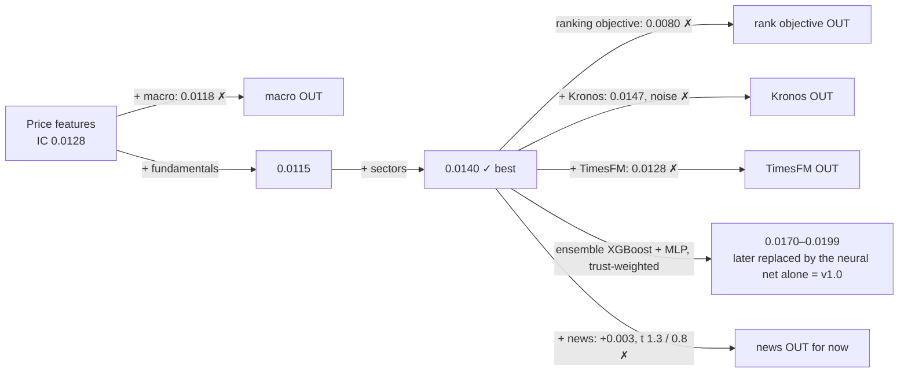

# Experiment & decision log

What we tried, what it scored, and whether it is **in**, **out** or **pending** in the final model, with the reason. Updated after every experiment. Detailed numbers: [`results.md`](results.md). Day-by-day log: [`PROGRESS.md`](PROGRESS.md).

**Rule for every decision:** a component stays only if it improves rank IC on the walk-forward test years 2012–2024 *consistently* (in most years, not just on average). Everything is compared on the same stocks, the same weekly dates and the same metrics; since 14 Nov that is the audited list "universe v2" (722 stocks). The 2025–26 holdout is never used for decisions.

**Current state in one line:** the ranking model is **v1.0, a neural net averaged over 3 seeds** (section below); price ranges in the product come from the **volatility range model**; news sentiment was tested on 17 Nov and **not adopted** (small gain (+0.003 rank IC at 5 and 20 days, 2018–2024) that is not distinguishable from chance (paired t 1.29 and 0.83); v1.0 stays). Rows further down that say "final" for an earlier model are kept as the record of how the choice was made, and are marked *replaced*.

## ⚠ Data error found 12 Nov 2026: the stock list stopped in January 2019

While checking the SEC event data, a bug was found in `scripts/build_universe.py`: it picked the repo's *original* membership file (ends 11 Jan 2019) instead of the *updated* one (runs to Aug 2026). Every result up to and including v1.0 was produced on that list.

| What was wrong | Effect |
|---|---|
| S&P 500 membership frozen at January 2019 | Stocks that joined later were never in the data (Tesla, Moderna, Uber, Palantir, ServiceNow… about 150). Stocks that left after 2019 were still treated as members |
| Companies that changed ticker after 2019 (FB → META, ANTM → ELV, HCP → DOC, about 30) | They dropped out of the data from the rename date |
| A few old symbols now used by other companies had the wrong company's prices inside the membership dates (EP = Empire Petroleum instead of El Paso in 2011–12; LB = LandBridge in 2024; HCP = HashiCorp in 2021–25) | A handful of non-index stocks were scored as if they were members |

What it does **not** mean: there was no look-ahead. Every forecast still used only past data, and every stock in the test was a real traded stock. The test years 2012–2018 used the correct point-in-time list. For 2019–2024 the test universe was "the January 2019 members that still traded under the same ticker", not the true S&P 500.

Fix (done in code, re-run pending): use the updated file (and refuse a stale one), join renames into one continuous membership, reject spells whose prices belong to another company, add earlier SEC registrant numbers for re-incorporated companies (Exxon, Disney, Alphabet, Cigna, Medtronic, BlackRock…). **All v1.0 numbers below will be re-measured on the corrected universe and reported side by side.**

### Rebuild and audit, 13 Nov 2026 → data freeze "universe v2"

The stock list was rebuilt on the corrected membership file and then audited against the price files (`python -m scripts.audit_universe`).

| Check | Result |
|---|---|
| Stocks with usable prices | 634 → **about 720** (738 price files; 18 belong to a later company under the same symbol and are never used) |
| True S&P 500 members with prices | Test years 2012–2024: 81% → 98% (average **91%**). Training years before 2012: average 67% |
| Wrong-company price histories inside membership dates | **6 found and dropped**: WEN, CSR, KMG, MIL, GAS (all before 2012 → training only) and **LSI 2000–May 2014** (Life Storage's prices under LSI Logic's symbol → 1 stock of ~405 in test years 2012–14) |
| How they were found | A real index member is heavily traded. The audit compares each stock's dollar trading volume with the other members of the same years; the five impostors traded under 5% of the typical member (KMG: 0.002%). GAS was found by checking the price against Nicor's known 2002 crash |
| SEC matches | A symbol whose SEC registrant keeps filing 400+ days after the prices ended is left out; CPWR left out by hand; earlier registrations (Exxon, Disney, Google … Marvell, Navient, FMC Technologies) accepted only when the SEC name matches |

Lesson recorded for the report: free price data keyed by ticker symbol is not safe for delisted stocks. Vendors show a reused symbol's history as the latest owner's. Every rebuild must end with the audit, and a commercial launch needs a data source keyed by a permanent security ID.

After this audit the universe is **frozen as "universe v2"**: all headline numbers are measured on it, and any later data fix is recorded here with a before/after.

## Locked model — LatticeIQ v1.0 (12 Nov 2026)

> **Neural net (MLP), average of 3 seeds**, on **price + fundamentals + sector** features (44), **634 S&P 500 stocks** (earlier list), cross-sectional ranks, winsorised target, prediction shrinkage. One model per horizon.

| Horizon | Rank IC | t-stat | Hit rate | Run |
|---|---|---|---|---|
| 5 days | **0.0136** | **2.63** | 50.5% | `20261112_1525_real_stock_h5_fund_sect` |
| 20 days | **0.0180** | **2.66** | 50.6% | `20261112_1541_real_stock_h20_fund_sect` |
| 60 days | **0.0229** | **2.39** | 51.3% | `20261112_1558_real_stock_h60_fund_sect` |

Significant (t > 2) at every horizon. Secondary model, also scored on the holdout: ensemble v2 (5d 0.0135, 20d 0.0159, 60d 0.0176).

**Final measurement on the audited stock list, "universe v2" (14 Nov 2026, 722 stocks):**

| Horizon | Rank IC | t-stat | Hit rate | Positive years | Run |
|---|---|---|---|---|---|
| 5 days | **0.0149** | **3.07** | 50.5% | 12 / 13 | `20261114_0752_real_stock_h5_fund_sect` |
| 20 days | **0.0197** | **3.18** | 50.7% | 10 / 13 | `20261114_0809_real_stock_h20_fund_sect` |
| 60 days | **0.0199** | **2.23** | 51.0% | 10 / 13 | `20261114_0827_real_stock_h60_fund_sect` |

Significant at every horizon, and the MLP still beats ensemble v2 (0.0141 / 0.0173 / 0.0123) and XGBoost (0.0094 / 0.0067 / 0.0016) at all three. The choice of model holds on the corrected data (run before the audit drops, 727 stocks: 0.0141 / 0.0192 / 0.0202). Watch points: 2024 is negative at 20 and 60 days; 2019 and 2021 are about zero at 20 days.

**Noise floor for judging add-ons.** The two corrected-list runs differ by five stocks, yet single years moved by up to 0.015 and the 13-year score by 0.0005–0.0008. An add-on counts only if it beats v1.0 by clearly more than that, in most years, measured in the same Kaggle job.

**Why the MLP and not the pre-declared ensemble v2 — stated openly.** Ensemble v2 was declared final before its run. Its results were good, but the 3-seed MLP alone was better at all three horizons in that run, and the single-seed MLP was also better than every ensemble at 20 and 60 days in the two runs before. That is 6 out of 6 comparisons on the full universe: XGBoost adds noise there (rank IC 0.006–0.010, t < 1.7). Choosing after seeing results is a mild form of test-set selection, so both models are kept and both will be scored once on the locked 2025–26 holdout; the MLP is the primary.

## Earlier candidate (before the full universe; replaced by v1.0)

> **Ensemble of XGBoost + neural net (MLP)**, each weighted by its trust score from the latest *training* years, on **price + fundamentals + sector** features, **634 stocks** (Tiingo + Yahoo fill-in), cross-sectional ranks, winsorised target, prediction shrinkage.
> 20-day rank IC **0.0170** (t **2.25**), positive in **11 / 13** years. On the earlier 466-stock universe the same method scored 0.0199 (t 2.36, 12 / 13 years): it is the best or near-best option on both universes. Price brackets: **quantile XGBoost + conformal calibration** (80% range covers 80.1%).

## Models

| Model | Status | Result (20-day) | Why |
|---|---|---|---|
| Random Walk (forecast = 0) | **IN** (baseline) | IC 0 | Every model must beat it |
| XGBoost regression + shrinkage | **replaced** (was the first main model) | IC 0.0140, t 1.80, 11/13 years | Best and most consistent |
| XGBoost ranking objective (rank:pairwise) | **OUT** | IC 0.0080, t 1.09 | Worse than regression on the same features |
| Quantile XGBoost + conformal (price ranges) | **replaced in the dashboard** by the volatility range model; side-by-side run on universe v2 pending | 80% range covers 79.8% / 80.3% / 80.2% at 5 / 20 / 60 days (naive 79.3 / 77.5 / 76.5); 90% range 90.0 / 90.4 / 90.8 | Calibrated at every horizon; beats the naive normal baseline. Weak in 2020 (71.5%) |
| P(up) from the range model | **OUT** | Brier 0.2513 vs base rate 0.2446 (20d); worse at 5d and 60d too; rank IC −0.009 | Does not beat "stocks rose 57% of the time"; extreme values badly wrong. The app shows the historical up-rate as context and the v1.0 rank-group record instead |
| Kronos-small, zero-shot, alone | **OUT** | IC 0.0087, t 0.81, 7/13 years | Weaker and inconsistent; forecasts too large (RMSE 0.140 vs 0.074) |
| XGBoost + Kronos forecasts as features | **OUT** | IC 0.0147 vs 0.0140 | +0.0007 is noise (better 6 yrs, worse 5); needs a daily GPU run. Fine-tuning dropped (see below); finance-pretrained models are the next try |
| TimesFM 2.5, zero-shot, alone | **OUT** | IC −0.0017, t −0.27, 7/13 years | No skill at ranking stocks: forecasts stay close to "no change" (spread between stocks 1.6%) |
| XGBoost + TimesFM forecasts as features | **OUT** | IC 0.0128 (t 1.55) vs 0.0140 | Makes the model worse (9/13 positive years vs 11/13): extra noisy inputs |
| ARIMA (per stock) | **PENDING** | — | Classical baseline for the report |
| LightGBM | **OUT** | IC 0.0080, t 1.00 | Its rankings are 86% the same as XGBoost's, so it adds a second vote for trees, not new information; it pulled the ensemble down to 0.0143 |
| Small neural net (MLP, PyTorch) | **became v1.0** (as an average of 3 seeds) | IC 0.0149, t 1.96, 10/13 years | Best single model; only 43% correlated with XGBoost, strong in 2012–17 where XGBoost was weak |
| Ridge (linear) | **OUT** | IC 0.0042, t 0.41 | Too simple; lowers any ensemble it joins |
| **Ensemble: XGBoost + MLP** (equal-weight rank average) | **replaced** | **IC 0.0168, t 2.04, 11/13 years** | +20% over XGBoost alone, and stable: 0.0171 in 2012–17, 0.0163 in 2018–24 (XGBoost alone: 0.0057 / 0.0209). Members chosen by how *different* their predictions are (correlation, no test outcomes used); equal weights fixed in advance |
| Ensemble: XGBoost + LightGBM + MLP | OUT | IC 0.0143 | Two near-identical tree models outvote the neural net |
| Equal-weight XGBoost + MLP | **replaced** | 466 stocks 0.0168 · 634 stocks 0.0147 | On the full universe XGBoost alone fell to 0.0064 and dragged the equal mix down |
| **Trust-weighted XGBoost + MLP** | **replaced** by v1.0 on the full list | 466 stocks **0.0199** (t 2.36) · 634 stocks **0.0170** (t 2.25) | Each year, each model's weight = its shrinkage k, i.e. how well it predicted the most recent *training* years. A model that stopped working gets little weight automatically. No test-year data is used. Most stable choice across both universes |
| Ensemble weights = k (v1) | **replaced by v2** | 5d 0.0120 · 20d 0.0170 · 60d 0.0161 | k measures size calibration, not ranking skill: XGBoost kept ~40–60% weight at 20/60 days while ranking poorly |
| Ensemble v2: weights = ranking skill (rank IC) on the latest training years; MLP = average of 3 seeds | **secondary**: scored once on the holdout next to v1.0 | 5d 0.0135 (t 2.37) · 20d 0.0159 (t 1.99) · 60d 0.0176 (t 1.69) | Same idea, but the weight measures what the product needs (ordering stocks). Seed-averaging removes the luck of one neural-net training run. Decided before seeing its test results; whatever it scores is locked |
| **MLP, average of 3 seeds** | **IN — v1.0 primary** | 5d 0.0136 (t 2.63) · 20d 0.0180 (t 2.66) · 60d 0.0229 (t 2.39) | Best at every horizon on 634 stocks; seed averaging made it steadier (single seed: 0.0112 / 0.0192 / 0.0254) |
| MLP alone, single seed | replaced | 466: 0.0149 · 634: 0.0192 (t 2.97) | Best on the full universe but weaker on the smaller one: more variable than the weighted ensemble |
| Regime models | **later** | — | Not started |
| Kronos fine-tuned on US stocks | **dropped** | — | Published evidence (arXiv 2511.18578): fine-tuning general models on stock returns gives little; finance-pretrained weights already exist (FinText) and are tested instead |

## v1.1 candidates (being tested; each kept only if it beats v1.0 on the same test years)

| Candidate | Status | What it is | Bar to beat |
|---|---|---|---|
| **Crash-risk model** (new output) | **PENDING — Kaggle run** | P(stock falls > 10% within 20 days), XGBoost classifier + isotonic calibration, inputs include raw volatility, beta, run-up, VIX/credit, days since last filing (earnings cycle) | A volatility-only logistic model (risky stocks crash more): must beat it on AUC and Brier skill, and be calibrated |
| **Sector-neutral target** | **PENDING — Kaggle run** | Models learn "beat your own sector ETF" instead of "beat SPY"; still scored on beating SPY | v1.0 MLP: 5d 0.0136 · 20d 0.0180 · 60d 0.0229 |
| **Recovery model** (new output) | **PENDING — Kaggle run** | After a crash (drop of 10%+ in 5 days): history table of how often and how fast stocks got back to the pre-drop price (by crash type), plus P(recover within 60 / 20 days) from what is known on the crash day | Base rate and a drop-size-only logistic model; must be calibrated |
| **Official company news: SEC 8-K events** | **data downloaded** (170,000 filings since 2001, shown in the dashboard); features not written yet | Every 8-K since ~2001 with its event type (earnings, restatement, CEO change, write-down, bankruptcy…), time-stamped. Same source gives history (to back-test as features) and a live feed (`--latest`) | Features must beat v1.0; live feed is shown as alerts until then |
| **Sharper price ranges** | **v1 built and measured (15 Nov), in the dashboard** — see the row below; Kaggle comparison with the quantile model still to run | Goal: the narrowest range that is still right as often as it says. Quick checks on our prices (5 days, 80% level, 2012–2024): (1) blending range-based (Garman-Klass), 60-day, 250-day and EWMA volatility gives ranges **5% narrower** at the same hit rate than 20-day volatility alone; (2) in weeks with an earnings report a one-size range holds the price only **57%** of the time (81% in other weeks) → make ranges earnings-aware: wider in earnings weeks, about 3–4% narrower otherwise; (3) adaptive conformal calibration so coverage recovers quickly in shocks like 2020; (4) score with the interval (Winkler) score, which rewards narrow and punishes misses | Current quantile-XGBoost ranges on universe v2: same or better coverage, lower interval score, and ≥ 75% coverage in earnings weeks |
| **Volatility range model** (`src/models/vol_ranges.py`) | v1 **replaced** by v2 on 17 Nov (row below) | Range centred on today's price; width = blended volatility (range-based, 60-day, 250-day, recent-weighted) × a multiplier fitted on past windows, separate for windows with an expected earnings report. Walk-forward 2012–2024, about 306,000 forecasts per horizon: the 80% range held **79.5% / 79.0% / 79.1%** at 5 / 20 / 60 days with average width **9.2% / 19.0% / 33.3%**; in earnings windows 77.3% / 78.2% / 79.3%. The quantile-XGBoost ranges on the earlier list: 79.8% / 80.3% / 80.2% at width 9.4% / 19.8% / 35.1%. So: a little narrower, a little under target, far simpler, and no longer blind in earnings weeks | Decide between the two (or blend) after both run on universe v2 with the interval score |
| Option-implied volatility | later | The options market's own forecast of each stock's movement; the strongest known input for range width. No free source with history found yet | Ranges above |
| Insider trading (SEC Form 4) | next | Executives' own buying/selling | v1.0 |
| **Finance-pretrained Chronos (FinText)** | next, after the rebuild | Chronos-Small trained from scratch on US daily excess returns, one version per year (Apache-2.0). For test year Y we use the version trained to Y−1, so no look-ahead. Tested alone and as 2–3 extra inputs to the MLP | v1.0; kept only if the gain holds in most of the 13 years |
| Short interest (FINRA) | later | How heavily a stock is bet against | v1.0 |
| News headlines + sentiment | **NOT ADOPTED** (17 Nov) | Headlines scored by FinBERT; Alpaca news from 2015. Small gain (+0.003 rank IC at 5 and 20 days, 2018–2024) that is not distinguishable from chance (paired t 1.29 and 0.83); v1.0 stays (results.md 5e) | — |

## Improvement search (17 Nov 2026): what research and data could still help

v1.0 stays locked. Each idea below is tested against it on the same years and kept only if it beats it by more than chance in most years; if nothing does, v1.0 stays the model.

**For the ranking (which stocks beat the market):**

| Idea | Evidence | Data, cost | Fits our horizons? | Order |
|---|---|---|---|---|
| News sentiment (FinBERT) | Media tone predicts short-term returns (Tetlock 2007) | Alpaca/Benzinga, downloaded and scored | Mostly 1–5 days | **Tested 17 Nov: not adopted** (+0.003, paired t 1.29 at 5 days, 0.83 at 20; results.md 5e) |
| Sentiment from a stronger language model | Kirtac & Germano (2024): OPT beat FinBERT (3-day direction accuracy 74.4% vs 72.2%; long-short Sharpe 3.05 vs 2.07, before costs). Lopez-Lira & Tang: GPT-4 headline scores predict the next two days, not after; the effect shrank from 2021 to 2023 | Same news; compute on Kaggle | 5 days at most | **Not tried:** FinBERT news did not pass the bar, and this was conditional on it |
| Insider purchases (SEC Form 4) | Free EDGAR study, 2022–2026: +0.5% after 1 day, +1.0% after 5 days (t ≈ 5–6), nothing reliable after a month | SEC Insider Transactions Data Sets, free | 5 days | Next |
| SEC 8-K events | Our own filings data | Downloaded | 5–20 days | Next |
| Short interest | Classic predictor: heavily shorted stocks tend to lag | FINRA, twice a month; cost and history depth to confirm | 20–60 days | After the above |
| Sector-neutral target | Removes sector swings from what the model learns | Code ready | All | Queued |
| Finance-pretrained forecaster (FinText) | Rahimikia et al. (2025) | Free weights | All | Queued |
| Option-implied signals (volatility skew, implied-vs-realised spread) | The strongest known group in research (e.g. volatility skew, t ≈ 8.6 at 12 months in Doshi, Luo & Yae) | Needs options history: Alpaca starts only in Feb 2024 and history is paid; OptionMetrics through a university WRDS subscription | All | If WRDS access exists |
| 200+ published predictors (Open Source Asset Pricing) | Chen & Zimmermann: replicated library of signals | Free files on Hugging Face, but keyed to CRSP identifiers and partly CRSP-based | All | If WRDS access exists |

**For the price ranges (narrower at the same hit rate):**

| Idea | Evidence | Data | Order |
|---|---|---|---|
| News counts | Bodilsen & Lunde (2025): the count of overnight firm news improves next-period volatility forecasts; macro-news tone helps at longer horizons | Downloaded | Next |
| Implied volatility | The market's own forecast of each stock's swings, generally the strongest volatility predictor | Options history (WRDS OptionMetrics) | If WRDS access exists |
| Confirmed earnings dates | Avoids widening for earnings that are not in the window | An earnings calendar source | Later |

**One question decides the top of this list:** if the university has WRDS, it gives (for academic use only) delisting-safe prices (CRSP), company accounts (Compustat), analyst estimate history (I/B/E/S), and option-implied volatility (OptionMetrics). Those are the data behind most published results and would also fix the free-data gaps listed in `data-sources.md`.

## Feature groups

| Group | Status | Result | Why |
|---|---|---|---|
| Price & volume (17) | **IN** | IC 0.0128 alone | Core signal: momentum, reversal, volatility |
| Macro (8: VIX, yields, spreads, CPI…) | **OUT** | IC 0.0118 (t 0.99) vs 0.0128 | Same value for every stock on a date, so it cannot help rank stocks |
| Fundamentals (15, SEC EDGAR) | **IN** | 0.0115 alone, 0.0140 with sectors | Helps in combination with sector-relative features |
| Sector features (12) | **IN** | 0.0115 → 0.0140 | Biggest single gain; compares stocks within their sector |
| News sentiment (FinBERT on headlines) | **OUT for now** (17 Nov) | 5 d 0.0142 vs 0.0111; 20 d 0.0125 vs 0.0099 (2018–2024) | Gain not distinguishable from chance: paired t 1.29 / 0.83, about twice the gap between two runs of the same model; worse in 3 of 7 years at 20 days; top and bottom fifths no better. Code kept for a retest. FinBERT licence is non-commercial anyway |
| Kronos forecasts (2) | **OUT** | see Models | No reliable gain |
| TimesFM forecasts (3) | **OUT** | 0.0140 → 0.0128 | Hurts ranking; see Models |

## Method choices

| Choice | Decision | Why |
|---|---|---|
| Target | Excess return vs SPY, 5/20/60 days; 20 days is the headline | What a user acts on: "will this stock beat the market?" |
| Evaluation | Walk-forward 2012–2024, 60-day embargo, weekly dates | Mimics real use; embargo stops overlapping targets leaking |
| Main metric | Rank IC with Newey-West t-stat | The product ranks stocks; NW handles overlapping 20-day targets |
| Holdout 2025–26 | Locked until the model is final | One honest final test, never tuned on |
| Features ranked across stocks per date | Yes | Removes market-wide level shifts; more stable |
| Target winsorised 1%/99% | Yes | Extreme moves (takeovers, crashes) otherwise dominate training |
| Prediction shrinkage | Yes | Scales forecasts to the skill seen in training; avoids overconfident numbers |
| P(up) calibration | Isotonic, tried, **dropped with P(up)** | Did not help: calibration years and test years are in different market regimes |
| Kronos grid | Monthly, 2 samples | Weekly would take ~10 GPU h; monthly forecasts still cover every period |

## Key finding: pretrained models vs our model

Two large pretrained forecasting models were tested zero-shot on the same stocks, dates and metrics:

| | Rank IC (20-day) | t-stat | Verdict |
|---|---|---|---|
| **Our XGBoost (price + fundamentals + sectors)** | **0.0140** | **1.80** | best |
| Kronos-small (trained on market candles) | 0.0087 | 0.81 | weaker, inconsistent |
| TimesFM 2.5 (general time series) | −0.0017 | −0.27 | no skill |

Each pretrained model sees **one stock's price history at a time**. Our model compares **all stocks on the same day** and adds company fundamentals and sector context. For "which stock will beat the market", the cross-sectional, finance-specific model wins. This matches the finance literature: a single price series alone carries little predictable signal. Finance-pretrained models (FinText) are the next thing to try; see the survey below.

## Open-source model survey (13 Nov 2026)

Question: which open-source pretrained model is worth fine-tuning or adding for this product? Checked on Hugging Face and in two 2025–26 papers. Licence matters because the product is commercial.

| Model | What it is | Licence | Commercial use | Fit for "which stock beats the market" | Decision |
|---|---|---|---|---|---|
| **FinText Chronos-Small / TimesFM-20M** (`FinText/Chronos_Small_<year>_US`, `…_Augmented`, `…_Global`) | Chronos / TimesFM architectures trained **from scratch on daily stock excess returns** (US 1990→year; 24 yearly versions ending 2023) | Apache-2.0 | Yes | Best match: trained on our kind of data, and the yearly versions fit walk-forward testing exactly | **TEST NEXT** |
| Chronos-2 (`amazon/chronos-2`, 120M) | General forecaster; can read related series and extra inputs together | Apache-2.0 | Yes | Strongest general model, but general pretraining did not transfer to stock returns in the papers | Second choice (only if FinText helps) |
| Kronos-base (`NeoQuasar/Kronos-base`, 102M) | Bigger version of Kronos (market candles) | MIT | Yes | Kronos-small added nothing; its training data may overlap our test years | Not now |
| TimesFM 2.5 (200M) | General forecaster | Apache-2.0 | Yes | Tested: no skill (IC −0.0017) | OUT (tested) |
| TabICL v2 (`jingang/TabICL`) | Pretrained model for tables (our feature table) | BSD-3 | Yes | Works on the same inputs as the MLP; would need sub-sampling (millions of rows) | Optional third ensemble member |
| TabPFN-2.5 | Pretrained model for tables | Non-commercial | **No** (paid licence) | — | OUT (licence) |
| Moirai 2.0 | General forecaster | CC-BY-NC-4.0 | **No** | — | OUT (licence) |
| TiRex | General forecaster (35M) | NX-AI community licence (custom) | Unclear, needs legal reading | — | OUT (licence risk) |
| Toto (Datadog) | Forecaster for server metrics | Apache-2.0 | Yes | Wrong domain | OUT |

What the evidence says (Rahimikia, Ni & Wang 2025, "Re(Visiting) Time Series Foundation Models in Finance", arXiv 2511.18578; and arXiv 2606.27100):

- Off-the-shelf general models do poorly on daily stock returns: worse than CatBoost / XGBoost / LightGBM. Same as our Kronos and TimesFM tests.
- **Fine-tuning** a general model on financial data gave "limited improvements" and did not close the gap; most fine-tuned models got worse.
- **Pre-training from scratch on financial data** gave the large gains (Chronos-Small, 512-day window: long-short Sharpe 5.4 before costs vs 6.8 for CatBoost), and with extra data it reached the best direction accuracy (51.74% vs 51.16% for CatBoost).
- Even then, tree models stayed level or ahead on fit. So the realistic use is as **one more member/input** next to our model, not a replacement.

Limits to keep in mind: the paper predicts the **next day** for **all US stocks** (small stocks are more predictable), with daily trading and no costs. We predict 5/20/60 days for S&P 500 stocks, so the gain may be smaller or zero. It must be measured on our folds.

## What v1.0 can honestly claim (measured, 2012–2024, universe v2)

Compared with what other tools advertise: [`market-comparison.md`](market-comparison.md).

| Claim | Evidence (5 / 20 / 60 days) | OK to say? |
|---|---|---|
| "The ranking separates weaker from stronger stocks" | Top 20% beat bottom 20% by 0.12% / 0.46% / 0.76%, in 11 / 11 / 10 of 13 years | Yes |
| "Low-ranked stocks tend to lag the market" | Bottom 20% beat SPY only 48.4% / 47.7% / 47.4% of the time | Yes |
| "Top-ranked stocks beat the market" | Top 20% beat SPY 50.2% / 49.9% / 50.1% of the time | **No** — they roughly match it |
| "The 80% price range is right 80% of the time" | Volatility range model v2 (in the product): 79.2% / 78.8% / 79.1%; v1: 79.5% / 79.0% / 79.1%; first model: 79.8% / 80.3% / 80.2% (earlier list) | Yes |
| "We predict whether a stock goes up" | P(up) lost to the base rate | **No** |
| "X% accurate" or any profit figure | No trading strategy tested after costs | **No** |

## Product decisions

| Decision | Why |
|---|---|
| Host the dashboard on one AWS Lightsail server (Sydney, 1 GB, $7 a month) behind HTTPS (Caddy) with one shared password (17 Nov) | Same program as on the PC, so nothing new to test; fits the $10 budget. Measured: page build 0.7 GB peak, daily ranking 1.7–1.8 GB for about a minute (run in its own process, swap covers it). Private because Yahoo prices and FinBERT are research-only. Per-person logins (Cloudflare Access) and a licensed price feed come before any wider access |
| Hosted site opened: no login (19 Nov) | Asked for by the project lead, so the site can be shown without sharing a password. The password stays available in `.env`. Search engines are asked not to list the site (noindex header, robots.txt) because the free price data (Yahoo, Alpaca IEX) is licensed for personal or research use; check those terms or use a licensed feed before promoting it |
| Chat app (planned): user sends a ticker or a chart screenshot (e.g. TradingView), an LLM reads it and answers using **our model's** forecast | The LLM is only the interface (reads the image, explains in plain words). The forecast comes from our tested model, not from the LLM guessing from a picture |
| The screenshot is used to identify the stock and timeframe, not as the prediction input | A chart image holds less information than the price data we already have; image "pattern reading" is not reliable or testable |
| Every answer shows rank, price range, top drivers and the model's backtest record (no probability of going up: it was tested and dropped), plus "not investment advice" | Honest, explainable output builds trust; US rules on investment advice |
| Accuracy claims are only from walk-forward backtests and the locked holdout | Claims of 70–90% stock "accuracy" almost always come from look-ahead bias |

| **Volatility range model v2**: volatility forecast by regression (incl. market mood) + uneven up/down (17 Nov), **IN the dashboard** | Replayed in the product code on the same 306,000 stock forecasts per horizon as v1: 80% range held 79.2% / 78.8% / 79.1% (v1 79.5% / 79.0% / 79.1%), **2.2% / 3.4% / 4.9% narrower**; interval score better by 1.0% / 1.7% / 2.2% and in 11, 11 and 10 of 13 years; worst year 75.8→77.4%, 75.9→76.6%, 73.3→75.6% (results.md 5d) | Rejected in the same test: 18 multiplier groups (narrower by missing more), last-year adaptive blend (worse), separate multipliers for short-history stocks (worse) |
| Day's likely middle, high and low for the target day (17 Nov), **IN the dashboard** | "High below X" held 89.6% / 89.0% / 88.7%, "low above Y" 89.6% / 90.1% / 90.5% at 5 / 20 / 60 days, aimed at 90% | Shown next to the close range, not instead of it; on the stock page and the Track record page |
| One range by default on the stock page: the 80% range, "right 4 times in 5" (17 Nov) | Three ranges at once confused readers. 80% balances width and certainty and is the best-tested level (held 79.5% / 79.0% / 79.1%) | The 50% and 90% ranges are one click away and remembered; the API and the Track record keep all three |
| Ranges follow the price during the day (16 Nov), replacing "ranges stay fixed until the close" from earlier the same day | The product has to react to today's price. Keeping the width and only moving the centre would be slightly too narrow or too wide; instead the range made at the close is re-centred on the price now and sized for the time left to the same end date, half-width × √(days left ÷ days in window) | Slightly wide just after the open (the overnight move has already happened), exact at the close. Not a separately tested model: the track record still describes ranges made at the close, and the page says so |

| The model in daily use is v1.0 trained once on every date whose outcome is known, then only scored each day (16 Nov) | One more day of data does not change what 25 years taught it; retraining monthly or quarterly is enough. Scoring runs in numpy from saved weights, so the PC needs no PyTorch | The daily model also learns from 2025–26. That period is still not used to test or choose anything: the one-time holdout test trains its own model on data to 2024 |
| The trust factor k of the daily model is measured on the latest fifth of dates, which includes 2025–26 (16 Nov) | It is part of the tested recipe (`fit_shrunk`): a copy trained on the first 80% of dates is checked on the rest. For the daily model that rest runs from mid-2021 to late 2026 | One blended skill number over those five years was printed (+0.009 / +0.001 / +0.003 at 5 / 20 / 60 days). It is not the holdout test and nothing is chosen from it; the holdout test still trains its own model to 2024 and scores 2025–26 once |
| Daily scoring reuses the research feature code on the research prices continued with daily closing prices (16 Nov) | Two separate feature pipelines would drift apart. Checked on the test data: research prices cut three weeks early and continued from a differently scaled daily file gave identical scores (difference 0.0); more price history changed nothing | Scoring uses every filing, not only recent ones: limiting filings to 7 or 14 years changed the fundamental features of some stocks (NI, GPN, DD and others). The cause is not traced yet and is a v1.1 item: a current feature should not depend on filings that old |
| The daily price download also covers former index members that still trade (16 Nov) | The model's price features are ranks across every stock with a price that day, former members included, as in training | About 150 more downloads a day; they are not shown on the dashboard |

## Data decisions

| Decision | Why | Effect / plan |
|---|---|---|
| Universe = all S&P 500 members since 2000, only while they were members | Avoids survivorship bias | At first only 47% of departed stocks had prices; after the Yahoo fill-in and the 13 Nov rebuild, 98% of true members in the test years have prices (91% on average) |
| Universe expanded 466 → **634 stocks** (Yahoo fill-in) | Commercial product must cover the index; more training examples | XGBoost became unstable (0.0140 → 0.0064); the neural net improved (0.0149 → 0.0192) |
| Missing 196 tickers (after PCAR) filled from Yahoo Finance instead of paying for Tiingo | Free and immediate; checked against Tiingo on 25 overlapping tickers before use | Some delisted stocks are not on Yahoo → small extra survivorship gap. A commercial launch needs a licensed feed whichever source we use |
| Fundamentals: first-filed values, usable the day after filing | No look-ahead from restatements or late filings | — |
| Macro: ALFRED vintages | Uses values as first published | — |
| Data never committed to GitHub | Tiingo/Benzinga licences | Rebuilt with scripts (`data/README.md`) |
| Two price files: frozen research data (`data/clean/prices.parquet`) and a daily display copy (`data/live/prices.parquet`) (16 Nov) | The research downloaders fetch a ticker once and never again, so the research file stops on the download day. The dashboard was showing prices 5 to 8 trading days old, with different last days per stock. Updating the research file in place would change the data the v1.0 results were measured on | Models are tested on the frozen file only. The dashboard shows the daily copy (three years of Yahoo prices for current members, replaced in full on each update). The range multipliers still come from the frozen file, windows ended by 31 Dec 2024 |
| News comes from Alpaca's historical news API; only Benzinga articles are kept (16 Nov) | The direct Benzinga plan gave about 2 articles a day. Alpaca's probe shows 435–1,144 a day from 2015, naming 13–33% of index members. In 2026 a second publisher (fiscal.ai) triples the article count; keeping it would make "how much is this stock in the news" mean something different in the latest months than in the years the model learns from | News stays out of the model until it clearly beats v1.0 on the same test years (2018–2024, since news starts in 2015). The live stream is not needed: the historical endpoint also returns everything since yesterday |

## How to add an entry

After each experiment: add a row here (status IN / OUT / PENDING + one-line reason), the numbers to `results.md`, and a line to the `PROGRESS.md` work log.
