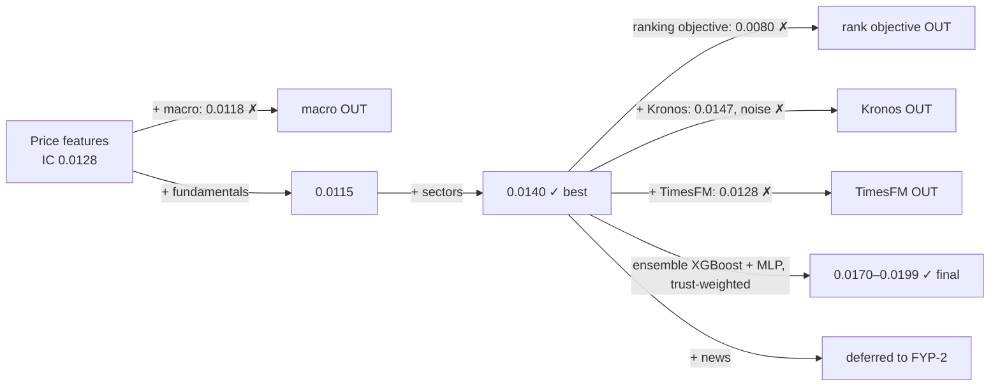

# Experiment & decision log

What we tried, what it scored, and whether it is **in**, **out** or **pending** in the final model, with the reason. Updated after every experiment. Detailed numbers: [`results.md`](results.md). Day-by-day log: [`PROGRESS.md`](PROGRESS.md).

**Rule for every decision:** a component stays only if it improves rank IC on the walk-forward test years 2012–2024 *consistently* (in most years, not just on average). Everything is measured on the same 466 stocks, the same weekly dates and the same metrics. The 2025–26 holdout is never used for decisions.

## ⚠ Data error found 12 Nov 2026: the stock list stopped in January 2019

While checking the SEC event data, a bug was found in `scripts/build_universe.py`: it picked the repo's *original* membership file (ends 11 Jan 2019) instead of the *updated* one (runs to Aug 2026). Every result up to and including v1.0 was produced on that list.

| What was wrong | Effect |
|---|---|
| S&P 500 membership frozen at January 2019 | Stocks that joined later were never in the data (Tesla, Moderna, Uber, Palantir, ServiceNow… about 150). Stocks that left after 2019 were still treated as members |
| Companies that changed ticker after 2019 (FB → META, ANTM → ELV, HCP → DOC, about 30) | They dropped out of the data from the rename date |
| A few old symbols now used by other companies had the wrong company's prices inside the membership dates (EP = Empire Petroleum instead of El Paso in 2011–12; LB = LandBridge in 2024; HCP = HashiCorp in 2021–25) | A handful of non-index stocks were scored as if they were members |

What it does **not** mean: there was no look-ahead. Every forecast still used only past data, and every stock in the test was a real traded stock. The test years 2012–2018 used the correct point-in-time list. For 2019–2024 the test universe was "the January 2019 members that still traded under the same ticker", not the true S&P 500.

Fix (done in code, re-run pending): use the updated file (and refuse a stale one), join renames into one continuous membership, reject spells whose prices belong to another company, add earlier SEC registrant numbers for re-incorporated companies (Exxon, Disney, Alphabet, Cigna, Medtronic, BlackRock…). **All v1.0 numbers below will be re-measured on the corrected universe and reported side by side.**

### Rebuild and audit, 13 Nov 2026 → data freeze "universe v2"

The stock list was rebuilt on the corrected membership file and then audited against the price files (`python -m scripts.audit_universe`).

| Check | Result |
|---|---|
| Stocks with usable prices | 634 → **about 720** (738 price files; 18 belong to a later company under the same symbol and are never used) |
| True S&P 500 members with prices | Test years 2012–2024: 81% → 98% (average **91%**). Training years before 2012: average 67% |
| Wrong-company price histories inside membership dates | **6 found and dropped**: WEN, CSR, KMG, MIL, GAS (all before 2012 → training only) and **LSI 2000–May 2014** (Life Storage's prices under LSI Logic's symbol → 1 stock of ~405 in test years 2012–14) |
| How they were found | A real index member is heavily traded. The audit compares each stock's dollar trading volume with the other members of the same years; the five impostors traded under 5% of the typical member (KMG: 0.002%). GAS was found by checking the price against Nicor's known 2002 crash |
| SEC matches | A symbol whose SEC registrant keeps filing 400+ days after the prices ended is left out; CPWR left out by hand; earlier registrations (Exxon, Disney, Google … Marvell, Navient, FMC Technologies) accepted only when the SEC name matches |

Lesson recorded for the report: free price data keyed by ticker symbol is not safe for delisted stocks. Vendors show a reused symbol's history as the latest owner's. Every rebuild must end with the audit, and a commercial launch needs a data source keyed by a permanent security ID.

After this audit the universe is **frozen as "universe v2"**: all headline numbers are measured on it, and any later data fix is recorded here with a before/after.

## Locked model — LatticeIQ v1.0 (12 Nov 2026)

> **Neural net (MLP), average of 3 seeds**, on **price + fundamentals + sector** features (44), **634 S&P 500 stocks** (earlier list), cross-sectional ranks, winsorised target, prediction shrinkage. One model per horizon.

| Horizon | Rank IC | t-stat | Hit rate | Run |
|---|---|---|---|---|
| 5 days | **0.0136** | **2.63** | 50.5% | `20261112_1525_real_stock_h5_fund_sect` |
| 20 days | **0.0180** | **2.66** | 50.6% | `20261112_1541_real_stock_h20_fund_sect` |
| 60 days | **0.0229** | **2.39** | 51.3% | `20261112_1558_real_stock_h60_fund_sect` |

Significant (t > 2) at every horizon. Secondary model, also scored on the holdout: ensemble v2 (5d 0.0135, 20d 0.0159, 60d 0.0176).

**Re-measured on the corrected stock list (13 Nov 2026, 727 stocks; before the six audit drops):**

| Horizon | Rank IC | t-stat | Hit rate | Positive years | Run |
|---|---|---|---|---|---|
| 5 days | **0.0141** | **2.84** | 50.4% | 11 / 13 | `20261113_1855_real_stock_h5_fund_sect` |
| 20 days | **0.0192** | **2.95** | 50.6% | 12 / 13 | `20261113_1914_real_stock_h20_fund_sect` |
| 60 days | **0.0202** | **2.23** | 51.0% | 9 / 13 | `20261113_1932_real_stock_h60_fund_sect` |

Still significant at every horizon, and the MLP still beats ensemble v2 (0.0137 / 0.0175 / 0.0130) and XGBoost (0.0092 / 0.0086 / 0.0033) at all three. The choice of model holds on the corrected data. Watch points: 60 days is less steady (four negative years) and 2024 is negative at 20 and 60 days.

**Why the MLP and not the pre-declared ensemble v2 — stated openly.** Ensemble v2 was declared final before its run. Its results were good, but the 3-seed MLP alone was better at all three horizons in that run, and the single-seed MLP was also better than every ensemble at 20 and 60 days in the two runs before. That is 6 out of 6 comparisons on the full universe: XGBoost adds noise there (rank IC 0.006–0.010, t < 1.7). Choosing after seeing results is a mild form of test-set selection, so both models are kept and both will be scored once on the locked 2025–26 holdout; the MLP is the primary.

## Earlier candidate (before the full universe)

> **Ensemble of XGBoost + neural net (MLP)**, each weighted by its trust score from the latest *training* years, on **price + fundamentals + sector** features, **634 stocks** (Tiingo + Yahoo fill-in), cross-sectional ranks, winsorised target, prediction shrinkage.
> 20-day rank IC **0.0170** (t **2.25**), positive in **11 / 13** years. On the earlier 466-stock universe the same method scored 0.0199 (t 2.36, 12 / 13 years): it is the best or near-best option on both universes. Price brackets: **quantile XGBoost + conformal calibration** (80% range covers 80.1%).

## Models

| Model | Status | Result (20-day) | Why |
|---|---|---|---|
| Random Walk (forecast = 0) | **IN** (baseline) | IC 0 | Every model must beat it |
| XGBoost regression + shrinkage | **IN** (main model) | IC 0.0140, t 1.80, 11/13 years | Best and most consistent |
| XGBoost ranking objective (rank:pairwise) | **OUT** | IC 0.0080, t 1.09 | Worse than regression on the same features |
| Quantile XGBoost + conformal (price ranges) | **IN — final on 634 stocks** | 80% range covers 79.8% / 80.3% / 80.2% at 5 / 20 / 60 days (naive 79.3 / 77.5 / 76.5); 90% range 90.0 / 90.4 / 90.8 | Calibrated at every horizon; beats the naive normal baseline. Weak in 2020 (71.5%) |
| P(up) from the range model | **OUT** | Brier 0.2513 vs base rate 0.2446 (20d); worse at 5d and 60d too; rank IC −0.009 | Does not beat "stocks rose 57% of the time"; extreme values badly wrong. The app shows the historical up-rate as context and the v1.0 rank-group record instead |
| Kronos-small, zero-shot, alone | **OUT** | IC 0.0087, t 0.81, 7/13 years | Weaker and inconsistent; forecasts too large (RMSE 0.140 vs 0.074) |
| XGBoost + Kronos forecasts as features | **OUT** | IC 0.0147 vs 0.0140 | +0.0007 is noise (better 6 yrs, worse 5); needs a daily GPU run. Revisit in FYP-2 (ensemble / US fine-tune) |
| TimesFM 2.5, zero-shot, alone | **OUT** | IC −0.0017, t −0.27, 7/13 years | No skill at ranking stocks: forecasts stay close to "no change" (spread between stocks 1.6%) |
| XGBoost + TimesFM forecasts as features | **OUT** | IC 0.0128 (t 1.55) vs 0.0140 | Makes the model worse (9/13 positive years vs 11/13): extra noisy inputs |
| ARIMA (per stock) | **PENDING** | — | Classical baseline for the report |
| LightGBM | **OUT** | IC 0.0080, t 1.00 | Its rankings are 86% the same as XGBoost's, so it adds a second vote for trees, not new information; it pulled the ensemble down to 0.0143 |
| Small neural net (MLP, PyTorch) | **IN** (ensemble member) | IC 0.0149, t 1.96, 10/13 years | Best single model; only 43% correlated with XGBoost, strong in 2012–17 where XGBoost was weak |
| Ridge (linear) | **OUT** | IC 0.0042, t 0.41 | Too simple; lowers any ensemble it joins |
| **Ensemble: XGBoost + MLP** (equal-weight rank average) | **IN — final model** | **IC 0.0168, t 2.04, 11/13 years** | +20% over XGBoost alone, and stable: 0.0171 in 2012–17, 0.0163 in 2018–24 (XGBoost alone: 0.0057 / 0.0209). Members chosen by how *different* their predictions are (correlation, no test outcomes used); equal weights fixed in advance |
| Ensemble: XGBoost + LightGBM + MLP | OUT | IC 0.0143 | Two near-identical tree models outvote the neural net |
| Equal-weight XGBoost + MLP | **replaced** | 466 stocks 0.0168 · 634 stocks 0.0147 | On the full universe XGBoost alone fell to 0.0064 and dragged the equal mix down |
| **Trust-weighted XGBoost + MLP** | **IN — final model** | 466 stocks **0.0199** (t 2.36) · 634 stocks **0.0170** (t 2.25) | Each year, each model's weight = its shrinkage k, i.e. how well it predicted the most recent *training* years. A model that stopped working gets little weight automatically. No test-year data is used. Most stable choice across both universes |
| Ensemble weights = k (v1) | **replaced by v2** | 5d 0.0120 · 20d 0.0170 · 60d 0.0161 | k measures size calibration, not ranking skill: XGBoost kept ~40–60% weight at 20/60 days while ranking poorly |
| Ensemble v2: weights = ranking skill (rank IC) on the latest training years; MLP = average of 3 seeds | **secondary** | 5d 0.0135 (t 2.37) · 20d 0.0159 (t 1.99) · 60d 0.0176 (t 1.69) | Same idea, but the weight measures what the product needs (ordering stocks). Seed-averaging removes the luck of one neural-net training run. Decided before seeing its test results; whatever it scores is locked |
| **MLP, average of 3 seeds** | **IN — v1.0 primary** | 5d 0.0136 (t 2.63) · 20d 0.0180 (t 2.66) · 60d 0.0229 (t 2.39) | Best at every horizon on 634 stocks; seed averaging made it steadier (single seed: 0.0112 / 0.0192 / 0.0254) |
| MLP alone, single seed | replaced | 466: 0.0149 · 634: 0.0192 (t 2.97) | Best on the full universe but weaker on the smaller one: more variable than the weighted ensemble |
| Regime models | **FYP-2** | — | After the ensemble |
| Kronos fine-tuned on US stocks | **dropped** | — | Published evidence (arXiv 2511.18578): fine-tuning general models on stock returns gives little; finance-pretrained weights already exist (FinText) and are tested instead |

## v1.1 candidates (being tested; each kept only if it beats v1.0 on the same test years)

| Candidate | Status | What it is | Bar to beat |
|---|---|---|---|
| **Crash-risk model** (new output) | **PENDING — Kaggle run** | P(stock falls > 10% within 20 days), XGBoost classifier + isotonic calibration, inputs include raw volatility, beta, run-up, VIX/credit, days since last filing (earnings cycle) | A volatility-only logistic model (risky stocks crash more): must beat it on AUC and Brier skill, and be calibrated |
| **Sector-neutral target** | **PENDING — Kaggle run** | Models learn "beat your own sector ETF" instead of "beat SPY"; still scored on beating SPY | v1.0 MLP: 5d 0.0136 · 20d 0.0180 · 60d 0.0229 |
| **Recovery model** (new output) | **PENDING — Kaggle run** | After a crash (drop of 10%+ in 5 days): history table of how often and how fast stocks got back to the pre-drop price (by crash type), plus P(recover within 60 / 20 days) from what is known on the crash day | Base rate and a drop-size-only logistic model; must be calibrated |
| **Official company news: SEC 8-K events** | **PENDING — download** | Every 8-K since ~2001 with its event type (earnings, restatement, CEO change, write-down, bankruptcy…), time-stamped. Same source gives history (to back-test as features) and a live feed (`--latest`) | Features must beat v1.0; live feed is shown as alerts until then |
| Insider trading (SEC Form 4) | next | Executives' own buying/selling | v1.0 |
| **Finance-pretrained Chronos (FinText)** | next, after the rebuild | Chronos-Small trained from scratch on US daily excess returns, one version per year (Apache-2.0). For test year Y we use the version trained to Y−1, so no look-ahead. Tested alone and as 2–3 extra inputs to the MLP | v1.0; kept only if the gain holds in most of the 13 years |
| Short interest (FINRA) | later | How heavily a stock is bet against | v1.0 |
| News headlines + sentiment | later | Headlines scored by a language model; no history to back-test yet, so shown as context, not used in the forecast numbers | — |

## Feature groups

| Group | Status | Result | Why |
|---|---|---|---|
| Price & volume (17) | **IN** | IC 0.0128 alone | Core signal: momentum, reversal, volatility |
| Macro (8: VIX, yields, spreads, CPI…) | **OUT** | IC 0.0118 (t 0.99) vs 0.0128 | Same value for every stock on a date, so it cannot help rank stocks |
| Fundamentals (15, SEC EDGAR) | **IN** | 0.0115 alone, 0.0140 with sectors | Helps in combination with sector-relative features |
| Sector features (12) | **IN** | 0.0115 → 0.0140 | Biggest single gain; compares stocks within their sector |
| News sentiment (Benzinga + FinBERT) | **DEFERRED (FYP-2)** | — | Plan delivers ~2 articles/day: too sparse to test. FinBERT licence is non-commercial |
| Kronos forecasts (2) | **OUT** | see Models | No reliable gain |
| TimesFM forecasts (3) | **OUT** | 0.0140 → 0.0128 | Hurts ranking; see Models |

## Method choices

| Choice | Decision | Why |
|---|---|---|
| Target | Excess return vs SPY, 5/20/60 days; 20 days is the headline | What a user acts on: "will this stock beat the market?" |
| Evaluation | Walk-forward 2012–2024, 60-day embargo, weekly dates | Mimics real use; embargo stops overlapping targets leaking |
| Main metric | Rank IC with Newey-West t-stat | The product ranks stocks; NW handles overlapping 20-day targets |
| Holdout 2025–26 | Locked until end of FYP-2 | One honest final test, never tuned on |
| Features ranked across stocks per date | Yes | Removes market-wide level shifts; more stable |
| Target winsorised 1%/99% | Yes | Extreme moves (takeovers, crashes) otherwise dominate training |
| Prediction shrinkage | Yes | Scales forecasts to the skill seen in training; avoids overconfident numbers |
| P(up) calibration | Isotonic, tried, **dropped with P(up)** | Did not help: calibration years and test years are in different market regimes |
| Kronos grid | Monthly, 2 samples | Weekly would take ~10 GPU h; monthly forecasts still cover every period |

## Key finding: pretrained models vs our model

Two large pretrained forecasting models were tested zero-shot on the same stocks, dates and metrics:

| | Rank IC (20-day) | t-stat | Verdict |
|---|---|---|---|
| **Our XGBoost (price + fundamentals + sectors)** | **0.0140** | **1.80** | best |
| Kronos-small (trained on market candles) | 0.0087 | 0.81 | weaker, inconsistent |
| TimesFM 2.5 (general time series) | −0.0017 | −0.27 | no skill |

Each pretrained model sees **one stock's price history at a time**. Our model compares **all stocks on the same day** and adds company fundamentals and sector context. For "which stock will beat the market", the cross-sectional, finance-specific model wins. This matches the finance literature: a single price series alone carries little predictable signal. Pretrained models remain an FYP-2 option (fine-tuning on US stocks, ensembles).

## Open-source model survey (13 Nov 2026)

Question: which open-source pretrained model is worth fine-tuning or adding for this product? Checked on Hugging Face and in two 2025–26 papers. Licence matters because the product is commercial.

| Model | What it is | Licence | Commercial use | Fit for "which stock beats the market" | Decision |
|---|---|---|---|---|---|
| **FinText Chronos-Small / TimesFM-20M** (`FinText/Chronos_Small_<year>_US`, `…_Augmented`, `…_Global`) | Chronos / TimesFM architectures trained **from scratch on daily stock excess returns** (US 1990→year; 24 yearly versions ending 2023) | Apache-2.0 | Yes | Best match: trained on our kind of data, and the yearly versions fit walk-forward testing exactly | **TEST NEXT** |
| Chronos-2 (`amazon/chronos-2`, 120M) | General forecaster; can read related series and extra inputs together | Apache-2.0 | Yes | Strongest general model, but general pretraining did not transfer to stock returns in the papers | Second choice (only if FinText helps) |
| Kronos-base (`NeoQuasar/Kronos-base`, 102M) | Bigger version of Kronos (market candles) | MIT | Yes | Kronos-small added nothing; its training data may overlap our test years | Not now |
| TimesFM 2.5 (200M) | General forecaster | Apache-2.0 | Yes | Tested: no skill (IC −0.0017) | OUT (tested) |
| TabICL v2 (`jingang/TabICL`) | Pretrained model for tables (our feature table) | BSD-3 | Yes | Works on the same inputs as the MLP; would need sub-sampling (millions of rows) | Optional third ensemble member |
| TabPFN-2.5 | Pretrained model for tables | Non-commercial | **No** (paid licence) | — | OUT (licence) |
| Moirai 2.0 | General forecaster | CC-BY-NC-4.0 | **No** | — | OUT (licence) |
| TiRex | General forecaster (35M) | NX-AI community licence (custom) | Unclear, needs legal reading | — | OUT (licence risk) |
| Toto (Datadog) | Forecaster for server metrics | Apache-2.0 | Yes | Wrong domain | OUT |

What the evidence says (Rahimikia, Ni & Wang 2025, "Re(Visiting) Time Series Foundation Models in Finance", arXiv 2511.18578; and arXiv 2606.27100):

- Off-the-shelf general models do poorly on daily stock returns: worse than CatBoost / XGBoost / LightGBM. Same as our Kronos and TimesFM tests.
- **Fine-tuning** a general model on financial data gave "limited improvements" and did not close the gap; most fine-tuned models got worse.
- **Pre-training from scratch on financial data** gave the large gains (Chronos-Small, 512-day window: long-short Sharpe 5.4 before costs vs 6.8 for CatBoost), and with extra data it reached the best direction accuracy (51.74% vs 51.16% for CatBoost).
- Even then, tree models stayed level or ahead on fit. So the realistic use is as **one more member/input** next to our model, not a replacement.

Limits to keep in mind: the paper predicts the **next day** for **all US stocks** (small stocks are more predictable), with daily trading and no costs. We predict 5/20/60 days for S&P 500 stocks, so the gain may be smaller or zero. It must be measured on our folds.

## What v1.0 can honestly claim (measured, 2012–2024)

Group figures below are from the earlier 634-stock list; they are re-measured with the final run. How these claims compare with what other tools advertise: [`market-comparison.md`](market-comparison.md).

| Claim | Evidence | OK to say? |
|---|---|---|
| "The ranking separates weaker from stronger stocks" | Top 20% beat bottom 20% by 0.11% / 0.40% / 0.80% over 5 / 20 / 60 days, in 12 / 12 / 11 of 13 years | Yes |
| "Low-ranked stocks tend to lag the market" | Bottom 20% beat SPY only 48.6% / 48.0% / 47.6% of the time | Yes |
| "Top-ranked stocks beat the market" | Top 20% beat SPY 50.0% / 49.9% / 50.3% of the time | **No** — they roughly match it |
| "The 80% price range is right 80% of the time" | 79.8% / 80.3% / 80.2% | Yes |
| "We predict whether a stock goes up" | P(up) lost to the base rate | **No** |

## Product decisions

| Decision | Why |
|---|---|
| Chat app (FYP-2): user sends a ticker or a chart screenshot (e.g. TradingView), an LLM reads it and answers using **our model's** forecast | The LLM is only the interface (reads the image, explains in plain words). The forecast comes from our tested model, not from the LLM guessing from a picture |
| The screenshot is used to identify the stock and timeframe, not as the prediction input | A chart image holds less information than the price data we already have; image "pattern reading" is not reliable or testable |
| Every answer shows rank, P(up), price range, top drivers and the model's backtest record, plus "not investment advice" | Honest, explainable output builds trust; US rules on investment advice |
| Accuracy claims are only from walk-forward backtests and the locked holdout | Claims of 70–90% stock "accuracy" almost always come from look-ahead bias |

## Data decisions

| Decision | Why | Effect / plan |
|---|---|---|
| Universe = all S&P 500 members since 2000, only while they were members | Avoids survivorship bias | Only 47% of departed stocks have prices → noted as a limitation |
| Universe expanded 466 → **634 stocks** (Yahoo fill-in) | Commercial product must cover the index; more training examples | XGBoost became unstable (0.0140 → 0.0064); the neural net improved (0.0149 → 0.0192) |
| Missing 196 tickers (after PCAR) filled from Yahoo Finance instead of paying for Tiingo | Free and immediate; checked against Tiingo on 25 overlapping tickers before use | Some delisted stocks are not on Yahoo → small extra survivorship gap. A commercial launch needs a licensed feed whichever source we use |
| Fundamentals: first-filed values, usable the day after filing | No look-ahead from restatements or late filings | — |
| Macro: ALFRED vintages | Uses values as first published | — |
| Data never committed to GitHub | Tiingo/Benzinga licences | Rebuilt with scripts (`data/README.md`) |

## How to add an entry

After each experiment: add a row here (status IN / OUT / PENDING + one-line reason), the numbers to `results.md`, and a line to the `PROGRESS.md` work log.
