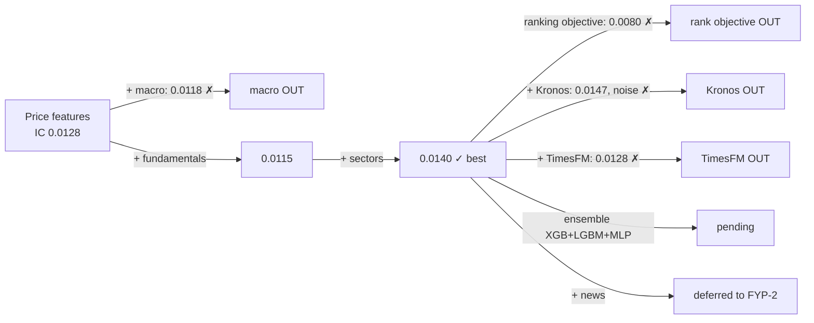

# Experiment & decision log

What we tried, what it scored, and whether it is **in**, **out** or **pending** in the final model, with the reason. Updated after every experiment. Detailed numbers: [`results.md`](results.md). Day-by-day log: [`PROGRESS.md`](PROGRESS.md).

**Rule for every decision:** a component stays only if it improves rank IC on the walk-forward test years 2012–2024 *consistently* (in most years, not just on average). Everything is measured on the same 466 stocks, the same weekly dates and the same metrics. The 2025–26 holdout is never used for decisions.

## Current final model (FYP-1 candidate)

> **XGBoost** on **price + fundamentals + sector** features, cross-sectional ranks, winsorised target, prediction shrinkage.
> 20-day rank IC **0.0140** (t 1.80), positive in **11 / 13** years. Price brackets: **quantile XGBoost + conformal calibration** (80% range covers 80.1%).

## Models

| Model | Status | Result (20-day) | Why |
|---|---|---|---|
| Random Walk (forecast = 0) | **IN** (baseline) | IC 0 | Every model must beat it |
| XGBoost regression + shrinkage | **IN** (main model) | IC 0.0140, t 1.80, 11/13 years | Best and most consistent |
| XGBoost ranking objective (rank:pairwise) | **OUT** | IC 0.0080, t 1.09 | Worse than regression on the same features |
| Quantile XGBoost + conformal (brackets) | **IN** | 80% coverage 0.801 vs naive 0.773 | Calibrated ranges; beats the naive normal baseline |
| Kronos-small, zero-shot, alone | **OUT** | IC 0.0087, t 0.81, 7/13 years | Weaker and inconsistent; forecasts too large (RMSE 0.140 vs 0.074) |
| XGBoost + Kronos forecasts as features | **OUT** | IC 0.0147 vs 0.0140 | +0.0007 is noise (better 6 yrs, worse 5); needs a daily GPU run. Revisit in FYP-2 (ensemble / US fine-tune) |
| TimesFM 2.5, zero-shot, alone | **OUT** | IC −0.0017, t −0.27, 7/13 years | No skill at ranking stocks: forecasts stay close to "no change" (spread between stocks 1.6%) |
| XGBoost + TimesFM forecasts as features | **OUT** | IC 0.0128 (t 1.55) vs 0.0140 | Makes the model worse (9/13 positive years vs 11/13): extra noisy inputs |
| ARIMA (per stock) | **PENDING** | — | Classical baseline for the report |
| LightGBM | **PENDING** | — | Second tree model with different errors; ensemble member |
| Small neural net (MLP, PyTorch) | **PENDING** | — | Learns smooth feature combinations trees miss; ensemble member |
| Ridge (linear) | **PENDING** | — | Simple, stable reference |
| **Ensemble** (XGBoost + LightGBM + MLP, equal-weight rank average) | **PENDING** | — | How quant firms combine models: different models make different mistakes, averaging cancels part of the noise. Equal weights fixed in advance, so no overfitting to test years |
| Regime models | **FYP-2** | — | After the ensemble |
| Kronos fine-tuned on US stocks | **FYP-2** | — | Pretrained route, ~3 days and uncertain; zero-shot versions did not help |

## Feature groups

| Group | Status | Result | Why |
|---|---|---|---|
| Price & volume (17) | **IN** | IC 0.0128 alone | Core signal: momentum, reversal, volatility |
| Macro (8: VIX, yields, spreads, CPI…) | **OUT** | IC 0.0118 (t 0.99) vs 0.0128 | Same value for every stock on a date, so it cannot help rank stocks |
| Fundamentals (15, SEC EDGAR) | **IN** | 0.0115 alone, 0.0140 with sectors | Helps in combination with sector-relative features |
| Sector features (12) | **IN** | 0.0115 → 0.0140 | Biggest single gain; compares stocks within their sector |
| News sentiment (Benzinga + FinBERT) | **DEFERRED (FYP-2)** | — | Plan delivers ~2 articles/day: too sparse to test. FinBERT licence is non-commercial |
| Kronos forecasts (2) | **OUT** | see Models | No reliable gain |
| TimesFM forecasts (3) | **OUT** | 0.0140 → 0.0128 | Hurts ranking; see Models |

## Method choices

| Choice | Decision | Why |
|---|---|---|
| Target | Excess return vs SPY, 5/20/60 days; 20 days is the headline | What a user acts on: "will this stock beat the market?" |
| Evaluation | Walk-forward 2012–2024, 60-day embargo, weekly dates | Mimics real use; embargo stops overlapping targets leaking |
| Main metric | Rank IC with Newey-West t-stat | The product ranks stocks; NW handles overlapping 20-day targets |
| Holdout 2025–26 | Locked until end of FYP-2 | One honest final test, never tuned on |
| Features ranked across stocks per date | Yes | Removes market-wide level shifts; more stable |
| Target winsorised 1%/99% | Yes | Extreme moves (takeovers, crashes) otherwise dominate training |
| Prediction shrinkage | Yes | Scales forecasts to the skill seen in training; avoids overconfident numbers |
| P(up) calibration | Isotonic, added | Raw P(up) was right 54.7% vs a 57.7% "always up" base rate |
| Kronos grid | Monthly, 2 samples | Weekly would take ~10 GPU h; monthly forecasts still cover every period |

## Key finding: pretrained models vs our model

Two large pretrained forecasting models were tested zero-shot on the same stocks, dates and metrics:

| | Rank IC (20-day) | t-stat | Verdict |
|---|---|---|---|
| **Our XGBoost (price + fundamentals + sectors)** | **0.0140** | **1.80** | best |
| Kronos-small (trained on market candles) | 0.0087 | 0.81 | weaker, inconsistent |
| TimesFM 2.5 (general time series) | −0.0017 | −0.27 | no skill |

Each pretrained model sees **one stock's price history at a time**. Our model compares **all stocks on the same day** and adds company fundamentals and sector context. For "which stock will beat the market", the cross-sectional, finance-specific model wins. This matches the finance literature: a single price series alone carries little predictable signal. Pretrained models remain an FYP-2 option (fine-tuning on US stocks, ensembles).

## Data decisions

| Decision | Why | Effect / plan |
|---|---|---|
| Universe = all S&P 500 members since 2000, only while they were members | Avoids survivorship bias | Only 47% of departed stocks have prices → noted as a limitation |
| Universe stops at tickers A–PCAR (466 stocks) | Tiingo free plan: 500 symbols/month | Full ~680 in FYP-2 |
| Fundamentals: first-filed values, usable the day after filing | No look-ahead from restatements or late filings | — |
| Macro: ALFRED vintages | Uses values as first published | — |
| Data never committed to GitHub | Tiingo/Benzinga licences | Rebuilt with scripts (`data/README.md`) |

## How to add an entry

After each experiment: add a row here (status IN / OUT / PENDING + one-line reason), the numbers to `results.md`, and a line to the `PROGRESS.md` work log.
