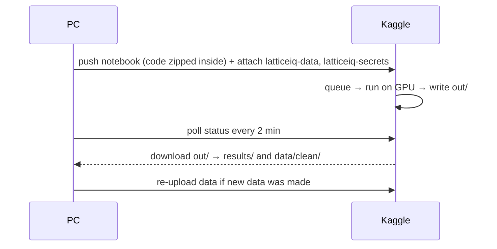

# Running jobs on Kaggle GPUs

Heavy work runs on Kaggle's free GPUs (2× T4, about 30 GPU hours per week). The PC only sends commands and downloads results. Everything goes through one script: `scripts/kaggle_cloud.py`.

## One-time setup

1. Kaggle account → Settings → **Create New Token** → save `kaggle.json` to `C:\Users\<you>\.kaggle\kaggle.json` (never into the repo).
2. Phone-verify the Kaggle account (needed for GPU and internet).
3. Upload keys and data as **private** Kaggle datasets:
   ```
   python -m scripts.kaggle_cloud upload-secrets     # .env -> private dataset latticeiq-secrets
   python -m scripts.kaggle_cloud upload-data        # data/clean/*.parquet -> private dataset latticeiq-data
   ```

## How a job works



## Commands

| Command | What it runs | GPU time |
|---|---|---|
| `experiments "<flags>" "<flags>"` | `scripts.run_experiment` once per flag set | ~15–30 min each |
| `brackets "<flags>"` | `scripts.run_brackets` | ~20 min each |
| `kronos --timing` | Kronos speed test | ~10 min |
| `kronos --years 2010 2024` | Kronos forecasts, both GPUs | ~1.7 h |
| `fundamentals-download` | SEC EDGAR download | CPU |
| `news-download --start 2015-01 --end 2019-12` | Benzinga download | CPU |
| `status <job>` / `download <job>` | Check / fetch a job | — |

Add `--no-wait` to start a job and return immediately.

Example:
```
python -m scripts.kaggle_cloud experiments "--data real --fundamentals --sectors" "--data real --fundamentals --sectors --kronos"
```

## Tips

- Kaggle allows **one GPU session at a time**. A second job waits in the queue; queued time uses no GPU hours.
- "Queued" for a long time usually means Kaggle is busy (US daytime) or has an outage (banner on kaggle.com). Do not push the same job again.
- Ctrl+C on the PC only stops watching; the job keeps running. Fetch it later with `download <job>`.
- Wait a few minutes after `upload-data` before starting a job, so Kaggle finishes processing the dataset.
- Check quota under Kaggle → Settings → Quotas.
