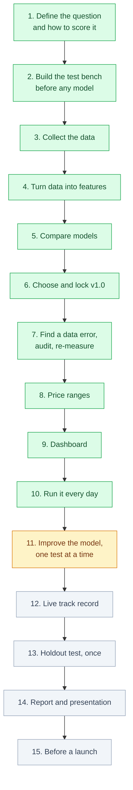

# LatticeIQ, step by step

This page tells the whole project as one sequence of steps: what we set out to do, what we did at each step, what came out, where the evidence is, and what is still ahead. It is written for a supervisor, a reviewer or a new team member, and it is updated whenever a step changes state.

_Last updated: 16 Nov 2026._

**In one paragraph.** LatticeIQ ranks every S&P 500 stock by how it is likely to do against the market (SPY) over the next 5, 20 and 60 trading days, and gives a calibrated range for where each price could be. The ranking model (v1.0, a small neural net) has a small but statistically significant edge over 13 test years (2012–2024), measured without any look-ahead on an audited list of index members. It now runs every day on one PC behind a three-page dashboard. We are testing whether news sentiment improves it. The 2025–26 data is locked for one final test.

| Symbol | Meaning |
|---|---|
| ✅ | Done |
| 🔄 | In progress |
| ⏳ | Not started |
| 🔒 | Locked on purpose until the model is final |

## The steps at a glance

| # | Step | Status | When |
|---|---|---|---|
| 1 | Define the question and how to score it | ✅ | 5 Nov |
| 2 | Build the test bench before any model | ✅ | 6 Nov |
| 3 | Collect the data | ✅ | 6–13 Nov |
| 4 | Turn data into features | ✅ | 7–9 Nov |
| 5 | Compare models | ✅ | 8–12 Nov |
| 6 | Choose and lock v1.0 | ✅ | 12 Nov |
| 7 | Find a data error, audit the data, re-measure | ✅ | 12–15 Nov |
| 8 | Price ranges | ✅ | 8–15 Nov |
| 9 | Dashboard | ✅ | 15–16 Nov |
| 10 | Run it every day | ✅ | 16 Nov |
| 11 | Improve the model, one test at a time | 🔄 | now |
| 12 | Live track record | ⏳ | next |
| 13 | Holdout test, once | ⏳ 🔒 | when the model is final |
| 14 | Report and presentation | ⏳ | by 28 Nov |
| 15 | Before a launch | ⏳ | later |

---

## Step 1. Define the question and how to score it ✅

**Why.** "Predict the stock price" cannot be tested fairly and invites inflated accuracy claims. A question needs a clear target and a clear score before any model is built.

**What we decided.**

- Target: a stock's return **minus SPY's** over the next 5, 20 and 60 trading days. The 20-day horizon is the headline. Beating the market is what an investor acts on, and it removes market-wide swings no model can call.
- Main score: **rank IC**, how well the predicted order of stocks matches the real order on each date. Also hit rate (direction against the market) and a Diebold-Mariano test against a "no change" forecast.
- Test method: **walk-forward**. For each year 2012–2024, train only on earlier years, leave a 60-trading-day gap, test on that year, move on.
- **Holdout:** everything from 1 Jan 2025 is locked and used once, at the end.
- Product rule: show ranks, ranges and the track record; no buy or sell calls.

**Where.** `config/settings.yaml`, `src/targets.py`, `src/folds.py`, [`decisions.md`](decisions.md) (method choices).

## Step 2. Build the test bench before any model ✅

**Why.** The most common way stock forecasts go wrong is look-ahead: using information that was not public on the forecast date. That is checked by tests, not by trust.

**What we did.**

- Point-in-time rules for every data type (prices up to the close, filings from the day after filing, index membership on that day, news after 4 pm counts for the next day).
- Automated tests that change future data and check no past feature moves; **random data must show no skill**; a **planted signal must be found**.
- A Random Walk baseline that every model must beat.
- Tests run on every push to GitHub.

**Result.** 43 tests pass today. On random data the model shows no skill (t near 0); on planted momentum it finds it (rank IC 0.10, t 13).

**Where.** `tests/test_pipeline.py`, `src/data/synthetic.py`, `src/eval/metrics.py`, [`architecture.md`](architecture.md#point-in-time-rules-no-look-ahead).

## Step 3. Collect the data ✅

**What we did.**

| Data | Source | Size |
|---|---|---|
| S&P 500 membership since 2000, with join and leave dates | Public membership history | 1,066 members |
| Daily prices 2000–2026 | Tiingo, filled in from Yahoo where Tiingo had no history (checked against Tiingo first) | 4.2 million rows |
| Company fundamentals, first-filed values with filing dates | SEC EDGAR | 1.2 million values |
| 8-K filings (earnings, restatements, executive changes…) | SEC EDGAR | 170,000 filings |
| Macro (VIX, yields, credit spread, CPI) | FRED / ALFRED | tested, not used |

**Problem met.** The free news plan (Benzinga) gave about 2 articles a day for the whole market: too thin. News was set aside and is now being retried with another source (step 11).

**Where.** `src/ingest/`, `scripts/build_universe.py`, [`data-sources.md`](data-sources.md).

## Step 4. Turn data into features ✅

**What we did.** 44 inputs per stock per day, each ranked across all stocks on that day:

- **Price and volume (17):** momentum, short-term reversal, volatility, distance from moving averages, beta.
- **Fundamentals (15):** value, profitability, growth, earnings surprise, reaction to the last filing, size.
- **Sector (12):** sector momentum and each stock's position inside its own sector (sectors worked out from prices, no outside labels).

**What we dropped.** Macro features: the same value for every stock on a day cannot help put stocks in order (rank IC 0.0118 with them vs 0.0128 without).

**Result.** Adding sector features gave the biggest single gain (0.0115 → 0.0140 at 20 days on the early list).

**Where.** `src/features/`, [`architecture.md`](architecture.md#features), [`results.md`](results.md) section 1.

## Step 5. Compare models ✅

**What we did.** Every model on the same stocks, dates and scores:

| Model | Rank IC, 20 days | Verdict |
|---|---|---|
| Random Walk | 0 | Baseline |
| XGBoost | 0.0140 (early list) → 0.0067 (full list) | Unstable as the list grew |
| LightGBM | 0.0080 | Repeats XGBoost, adds nothing |
| Ridge | 0.0042 | Too simple |
| XGBoost with a ranking objective | 0.0080 | Worse |
| Kronos (pretrained on market candles) | 0.0087 alone; +0.0007 as an input | Noise |
| TimesFM 2.5 (pretrained, general) | −0.0017 alone; makes the model worse as an input | No skill |
| Neural net (MLP) | 0.0149 → 0.0197 | **Best, and improved on the bigger list** |
| Ensembles of the above | 0.0130–0.0199 | Good on the small list, beaten by the neural net alone on the full list |

**What we learned.** Pretrained forecasting models look at one stock's history at a time. Ranking stocks needs a model that compares all stocks on the same day with company and sector context, which is what our model does. The literature says the same.

**Where.** [`decisions.md`](decisions.md) (every model with its reason), [`results.md`](results.md) sections 1–3.

## Step 6. Choose and lock v1.0 ✅

**What we chose.** A neural net (44 → 64 → 32 → 1) averaged over 3 random seeds, one per horizon, with a trust factor that shrinks each forecast towards "no excess return" according to how well the model did on its own latest training years.

**Stated openly.** An XGBoost + neural-net ensemble had been declared final before its run, but the neural net alone beat it in 6 of 6 comparisons. Choosing after seeing results is a mild form of selection, so **both** will be scored once on the holdout; v1.0 is the primary.

**Where.** [`decisions.md`](decisions.md#locked-model--latticeiq-v10-12-nov-2026), `src/models/ensemble.py`.

## Step 7. Find a data error, audit the data, re-measure ✅

**What happened.** On 12 Nov we found that the stock list had been built from a membership file that stopped in January 2019. About 150 stocks that joined later were missing (Tesla, Uber and Palantir among them), and about 30 renamed companies dropped out of the data from the rename date.

**What we did.**

1. Fixed the code and rebuilt the list from the correct file.
2. Wrote an audit (`scripts/audit_universe.py`) that compares each stock's trading volume with other index members. It found **six price histories that belonged to a different company** using a reused ticker, and removed them.
3. Froze the result as **"universe v2"**: 722 stocks; 98% of true members have prices in the test years (91% on average).
4. Re-measured v1.0 on it.

**Result.** The edge survived and got slightly stronger at 5 and 20 days:

| v1.0 | 5 days | 20 days | 60 days |
|---|---|---|---|
| Rank IC (t) | 0.0149 (3.07) | **0.0197 (3.18)** | 0.0199 (2.23) |
| Hit rate against the market | 50.5% | 50.7% | 51.0% |
| Positive test years | 12 of 13 | 10 of 13 | 10 of 13 |

Weak spots: 2024 is negative at 20 and 60 days; 2019 and 2021 are about zero at 20 days.

**Lesson recorded.** Free price data keyed by ticker symbol is not safe for delisted stocks; a commercial version needs data keyed by a permanent security ID.

**Where.** [`decisions.md`](decisions.md) (data error and audit), [`results.md`](results.md) section 0, runs `results/20261114_*`.

## Step 8. Price ranges ✅

**Why.** A rank says "better or worse than the market"; a user also wants to know how far the price could move.

**What we did.**

1. First model: quantile XGBoost with conformal calibration. Its 80% range held the price 79.8% / 80.3% / 80.2% of the time at 5 / 20 / 60 days.
2. Tested a "chance of going up" from the same model: it lost to the plain historical rate (stocks rose 57% of the time), so it was **dropped**.
3. Found that in weeks with an earnings report a one-size range held the price only 57% of the time.
4. Built a simpler **volatility range model** with a separate width for earnings windows. Its 80% range held 79.5% / 79.0% / 79.1%, and 77–79% in earnings windows. This is the one in the product.

**Where.** `src/models/vol_ranges.py`, `scripts/run_brackets.py`, [`architecture.md`](architecture.md#price-ranges).

## Step 9. Dashboard ✅

**What we built.** A local website with three pages:

- **Overview:** stocks up and down, two-week earnings calendar, biggest moves, calmest and wildest stocks, highest and lowest ranked, important filings.
- **Stocks:** today's price, the three ranges for 5 / 20 / 60 days, a chart with the range cone ahead and earnings marks, the model's rank against the market and what that rank did in testing, recent filings, and analysts' price targets (labelled as opinions, not tested).
- **Track record:** every range replayed on 2012–2024, said versus done, year by year.

**Where.** `app/`, `scripts/export_dashboard.py`, [`../app/README.md`](../app/README.md).

## Step 10. Run it every day ✅

**Problem met.** The first dashboard showed prices 5 to 8 trading days old, because the research data is frozen.

**What we built.**

- A separate daily price file (three years, replaced after every close) and delayed prices during market hours; the ranges follow the price during the day.
- **Train once, score daily:** v1.0 is trained once on all data on Kaggle (6 minutes) and saved; after every close the PC ranks every stock with plain NumPy, using the same feature code as the research. Every day's forecasts are written to a dated log before their outcomes are known.
- A local server that does all of this by itself and reloads the page after each close.

**Result.** One command, `python -m scripts.run_dashboard`, keeps everything current.

**Honest note.** While training, the daily model checks itself on mid-2021 to late 2026: rank skill +0.009 / +0.001 / +0.003 at 5 / 20 / 60 days. The edge has been thin recently and clearly positive only at 5 days. This is why step 11 matters.

**Where.** `src/models/production.py`, `src/ingest/live.py`, `scripts/run_dashboard.py`, [`architecture.md`](architecture.md#daily-model-train-once-score-daily), [`results.md`](results.md) section 0c.

## Step 11. Improve the model, one test at a time 🔄

**Rule.** An addition is kept only if it beats v1.0 on the same test years by clearly more than chance (two near-identical runs differ by 0.0005–0.0008 over 13 years), in most years.

| Candidate | State | Next action |
|---|---|---|
| **News sentiment** | 🔄 Alpaca has 435–1,144 articles a day from 2015, covering 13–33% of members on sampled days. Download and merge built and tested | Download on the PC, score sentiment on Kaggle, compare with and without news on 2018–2024 |
| Sector-neutral target | Code written | Run on Kaggle |
| SEC 8-K events as inputs | Filings downloaded | Write the features, then compare |
| Finance-pretrained forecaster (FinText Chronos) | ⏳ | Runner and comparison |
| Crash risk (fall of more than 10% in 20 days) | Code written | Run on Kaggle against a volatility-only model |
| Recovery after a crash | Code written | Run on Kaggle against the historical rate |
| Volatility ranges vs quantile XGBoost on universe v2 | ⏳ | One Kaggle run, scored on interval score |

**Where.** [`decisions.md`](decisions.md) (v1.1 candidates), [`PROGRESS.md`](PROGRESS.md) (current to-do).

## Step 12. Live track record ⏳

Score each logged daily forecast once its outcome is known (5, 20, 60 trading days later) and show the running result on the Track record page. This is the only evidence that cannot be affected by any choice we made, because the forecasts are on record before the outcome exists. Needs at least a week of logs to start.

## Step 13. Holdout test, once ⏳ 🔒

When the model is final: train v1.0 (and the secondary ensemble) on data up to the end of 2024, score 2025–26 once, and publish the result whatever it is. Nothing has been tested, tuned or chosen on this period. The setting is `holdout_start` in `config/settings.yaml`.

## Step 14. Report and presentation ⏳

Data, method, results with their limits, the data error and how it was handled, the claims we make and the ones we do not, and the plan ahead. Source material: this page, [`results.md`](results.md), [`decisions.md`](decisions.md), [`market-comparison.md`](market-comparison.md).

## Step 15. Before a launch ⏳

- Licensed price and news data keyed by a permanent security ID (the free sources used here are for research only).
- A sentiment model licensed for commercial use (FinBERT is non-commercial).
- Hosting, accounts and an API; a chat assistant that explains the model's forecast and never makes up its own.
- Legal review of every performance statement; no investment advice.

---

## How to check our work

| Question | How to check |
|---|---|
| Is there look-ahead? | `pytest -q` runs 43 tests, including "random data shows no skill"; GitHub Actions runs them on every push |
| Are the numbers real? | Each run's settings and metrics are in `results/<run>/`; runs `20261114_0752`, `0809`, `0827` hold the v1.0 headline numbers |
| Was the holdout used? | `holdout_start: "2025-01-01"` in `config/settings.yaml` is enforced by `src/folds.py`; there is a test for it |
| What do we claim? | The claims table in the [README](../README.md#what-we-claim-and-what-we-dont): what we say, what we do not, and why |
| How does it compare? | [`market-comparison.md`](market-comparison.md): what other tools and published research report, and how they measure it |

## Where everything else is

| Document | Use it for |
|---|---|
| [`../README.md`](../README.md) | The product, results, models picked and dropped, architecture, requirements |
| [`methodology.md`](methodology.md) | The methods in plain words, with the published research behind each one |
| [`architecture.md`](architecture.md) | Design detail |
| [`decisions.md`](decisions.md) | Every model and feature decision with its numbers |
| [`results.md`](results.md) | All results tables and limits |
| [`data-sources.md`](data-sources.md) | Every data source and its licence |
| [`PROGRESS.md`](PROGRESS.md) | Day-by-day work log and the current to-do list |
